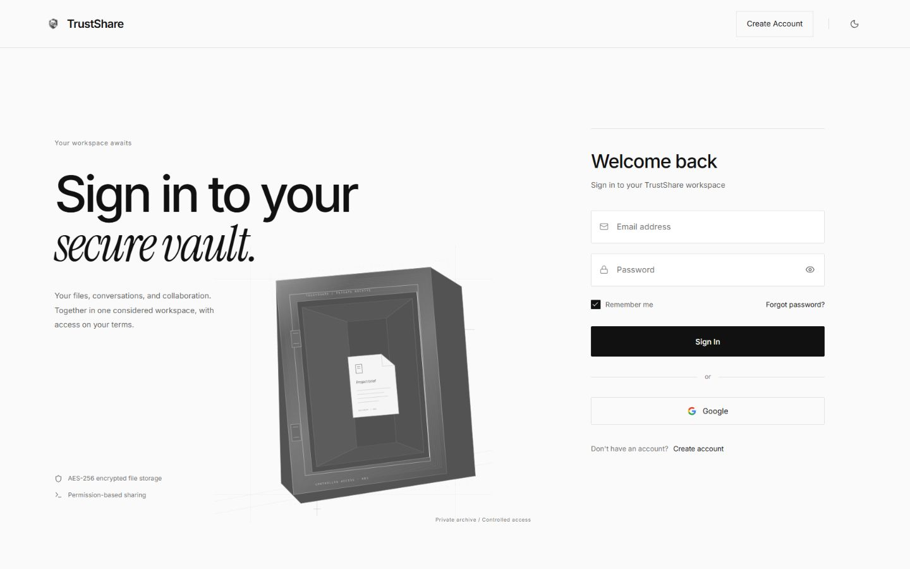
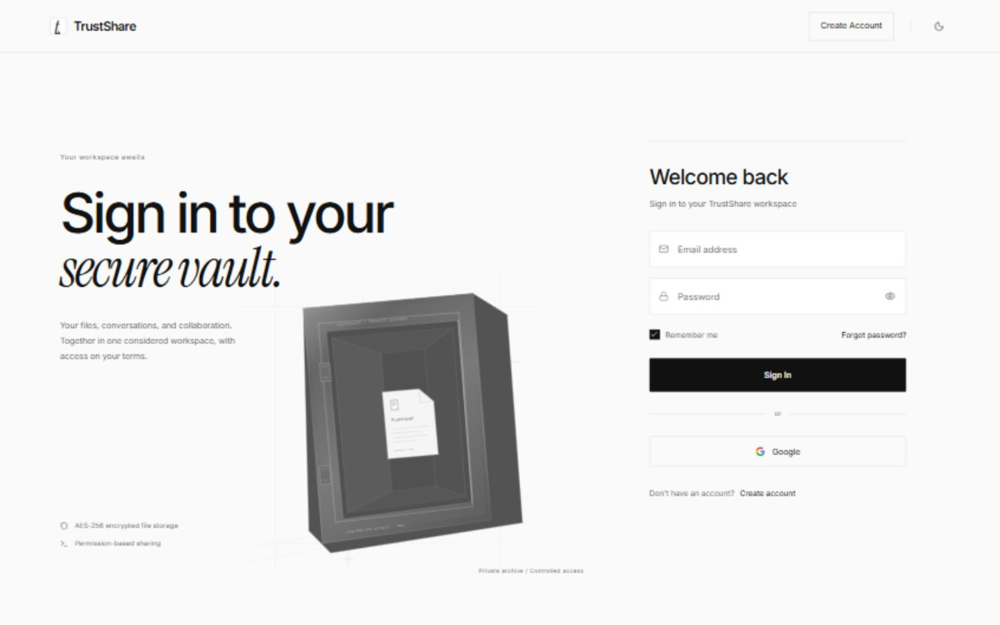
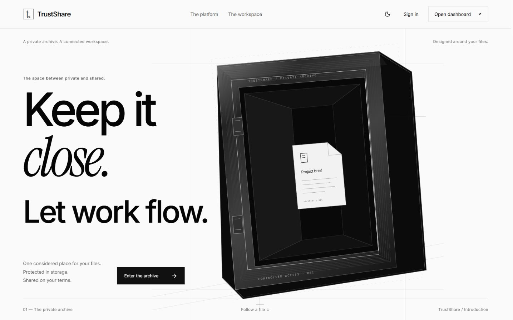
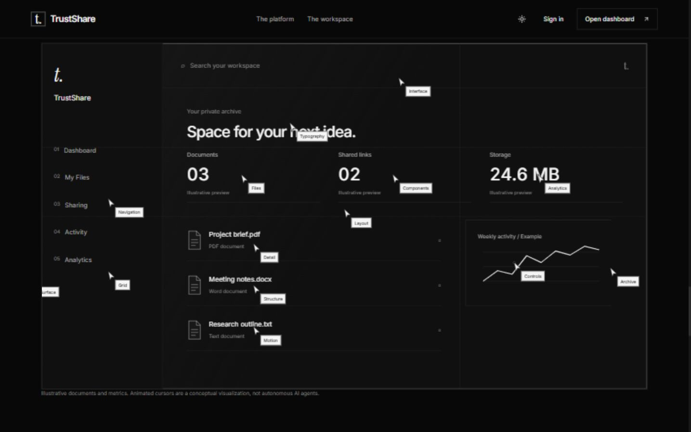
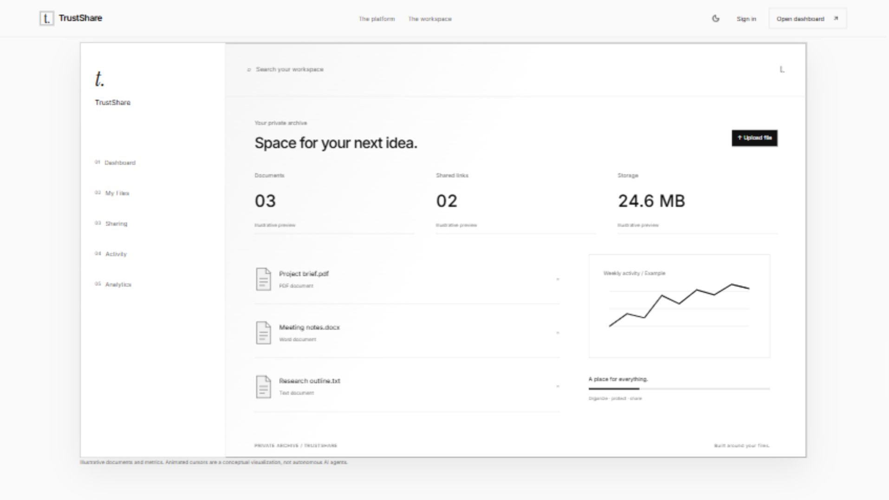
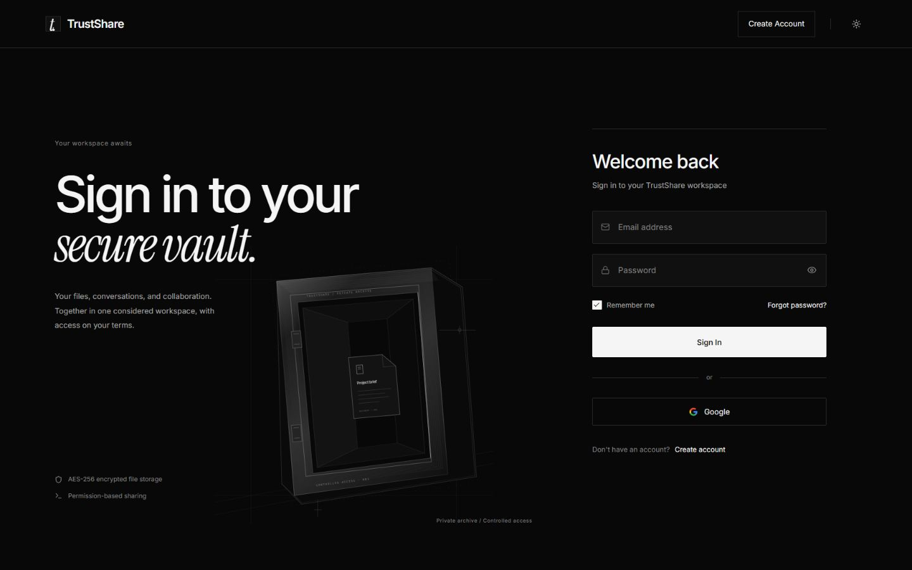
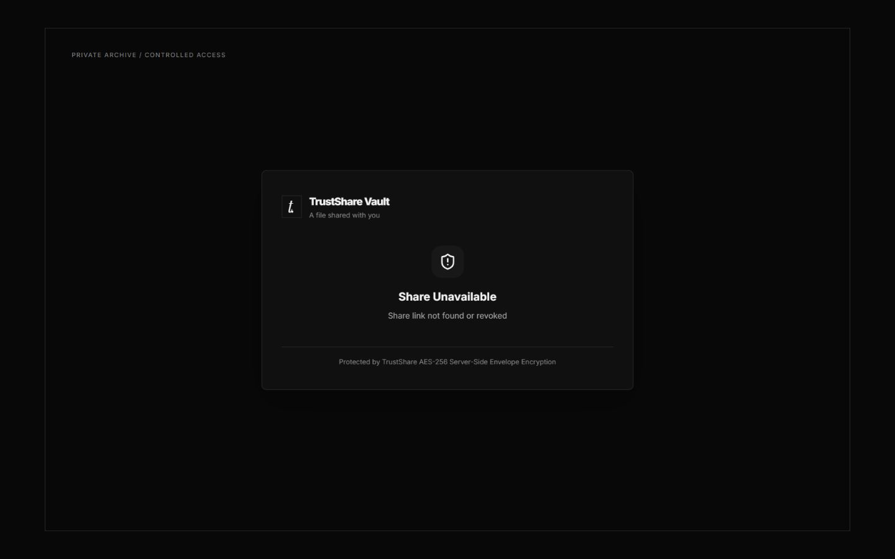

# TrustShare frontend refinement review

25 November 2026. Review branch: `codex/advanced-motion-refinement`, stacked over `codex/trustshare-editorial-experience` (9f45421). No deployment or merge is part of this change.

## Result and scope

The existing architectural introduction and continuous file journey remain. This pass adds a coordinated workspace construction sequence, radial theme switching, native SVG file/folder artwork, reusable branding and preparation/empty states, and more consistent workspace surfaces. Authentication, encryption, permissions, storage, metrics and assistant processing remain with their existing implementations.

Pre-existing local upload, OAuth/MFA, SMTP, backend and deployment changes are excluded from this review. The local preview includes that working-tree runtime; the staged callback and OTP files deliberately retain the base branch's authentication logic. They are presentation changes, not a release of those separate fixes.

## Design specification

| Element | Specification |
| --- | --- |
| Identity | Editorial `t.` mark, paired with TrustShare text; no downloaded logo dependency |
| Public typography | Existing Instrument Serif/Georgia editorial emphasis, responsive sans-serif headings |
| Workspace typography | Inter/Arial/system sans-serif; tabular figures; 14px assistant body with 1.7 line height |
| Light surfaces | Background #fafafa, panel #fff, secondary #f2f2f2, text #111, secondary text #5f5f5f |
| Dark surfaces | Background #080808, panel #101010, secondary #181818, text #f5f5f5, secondary text #a6a6a6 |
| Controls | Semantic accent/contrast pairs, visible borders and focus treatments; native input color scheme follows the active theme |
| Shape | Restrained 3–8px corners; document layers and architectural edges carry the visual identity |
| Motion | 160ms hover token, 280ms base token; 220ms navigation indicator; 540ms radial theme reveal |

Light authentication inputs use white surfaces and dark text. Export Report now uses the semantic contrasting foreground instead of an undefined color token. Upload rejection messages wrap. Revoked share cards retain readable text. Mobile search can shrink without pushing utility controls off-screen; hidden sidebars are also hidden from keyboard/accessibility navigation.

## Components and presentation

- `BrandMark`: shared text-native mark across authentication, sidebar, assistant and recipient views.
- `FileArtwork`: separate document/PDF, grid, image and media illustrations; accepts missing metadata safely. It never requests thumbnails or modifies user media.
- `PreparationMark`: document outline/scanning motif driven by existing loading states; no invented processing percentages.
- `ArchiveEmpty`: reusable first-upload/search-empty treatment using the original upload control.
- `SwarmConstruction` and `constructionSchedule`: independent elapsed-time scheduler, region tasks and cursor queues.
- Existing file/folder cards, preview toolbar, recipient panel, assistant header/empty conversation, Dashboard panels, sharing summary, activity feed, notifications and Settings surfaces are refined in place.
- Sidebar route selection moves using one shared Framer Motion layout indicator. Existing destinations and callbacks remain.

## Motion architecture

The vault keeps its existing pointer/scroll depth and receives additional edge/specular planes. The same document continues through arrival, protection, controlled sharing, organization and intelligence in `ArchiveJourney`; the established reduced-motion fallback remains. Particles now morph through dispersed, document, shield, archive and connected-ring formations, with deterministic interpolation for reverse scrolling.

The construction scene follows the particles and precedes the existing live-component product preview. Its metrics and documents are explicitly illustrative, separate from authenticated application data. It does not call AI, file, analytics or authentication APIs.

Construction has a 13,500ms deadline independent of scroll position and agent count. IntersectionObserver activates it once; a separate deadline timer completes it even after leaving the viewport. Rendering pauses off-screen, resumes at the correct elapsed position, and never replays on re-entry. ResizeObserver caches scene dimensions; cursor movement uses transforms without per-frame layout reads or React rerenders. Cleanup removes observers, RAF, timers and listeners. Desktop configuration provides 16 cursor slots (15 assigned tasks), tablet 10, mobile 5, and a smaller low-core configuration. Agent count can be overridden without changing the deadline. A skip link immediately assembles the scene and retains the native product anchor. Reduced motion renders the completed scene immediately.

Theme switching uses the supported View Transition API and a circular clip from the triggering button. Rapid clicks cannot overlap transitions. Missing/failed APIs and reduced motion use the existing instant state change; localStorage persistence remains. There is no scrollTo call. The duplicate outer ThemeProvider was removed so one provider owns theme effects.

## Browser validation

All browser work used the ChatGPT in-app browser and the local production bundle on port 3000. AWS was not changed.

| Check | Observed result |
| --- | --- |
| Existing administrator sign-in | Succeeded with the existing account; no credential change |
| Synthetic upload | `ui-regression.txt`, 197 bytes, completed successfully |
| Text preview and download | Contents rendered and browser download completed; downloaded SHA-256 matches the original fixture |
| Public link creation/access | View-only 24-hour link created; recipient preview rendered the synthetic contents |
| Revocation | Link was revoked after testing; recipient showed the actual rejection message |
| Activity/notifications | Existing upload/download/share events and recipient-view notification appeared |
| Light auth inputs | Computed white background, #111 foreground and `color-scheme: light` |
| Mobile utilities | Theme and notifications fit inside 390px; no document horizontal overflow |
| Construction timing | Browser samples completed in 13,507ms and 13,505ms, including scroll-away/re-entry |
| Desktop cursor count | 15 assigned visible cursors observed during assembly |
| Console | Final landing-page capture contained no recorded console errors |

Representative visual checks covered 1920px Dashboard/landing, 1440px authentication/files/sharing/analytics/notifications/activity/recipient, 1024px Dashboard, 768px file workspace and 390px authentication/files/settings/admin/recipient/construction. Both themes were inspected across representative public and authenticated views. This is not an exhaustive route-by-width-by-theme matrix. Member role visibility and protected-route behavior were covered by automated layout tests; no separate member browser session was used.

Reduced-motion completion, off-screen deadline, skip behavior, deterministic schedules, transition fallback, persistence and rapid-toggle protection have automated coverage. Native reduced-motion OS settings were not changed. No frame-rate, CPU, Lighthouse or screen-reader benchmark is claimed. Legacy dialogs still need a dedicated focus-containment/accessibility pass.

## Build and tests

- Production `npm run build` with `CI=false`, `BUILD_PATH=build-refinement-production`: completed with existing lint/bundle-size warnings. Main JS is 570.96kB gzip and main CSS 46.13kB; the lazy landing chunk is 8.20kB JS plus 4.55kB CSS. The large shared bundle remains a performance limitation.
- `CI=true` build stops on the repository's existing warnings (unused imports and effect dependencies); these were not suppressed or changed through unrelated business-effect edits.
- Full suite: **74 passed, 9 failed, 83 total; 14 passing and 5 failing suites**. The earlier baseline had 12 failures. Three public-recipient tests now pass after updating stale button/field labels to the current presentation.
- Remaining baseline failures: FileDragDrop payload/class expectations (3), Notifications labels/actions (3), Activity loading/data expectations (2), Sharing missing mock/export (1); NavbarNotifications fails at suite setup because Jest does not transform the existing `react-markdown` ESM dependency.
- Focused final run: **37 tests passed across 7 suites**. A source AST audit verifies **82 existing functions/effects unchanged**, plus the callback's complete nonvisual logic matching its pre-task working tree. The staged auth audit also checks callback/OTP logic against the base branch.
- An isolated export of the exact staged source also completed its production build with existing warnings and passed the same **37 focused tests**. That review build is 570.43kB main JS gzip and 46.13kB main CSS; its smaller JS size reflects exclusion of unrelated working-tree changes. Scope/credential-pattern checks passed for all 67 staged paths.

## Known limitations intentionally preserved

The local assistant reports Setup Required, so provider-backed conversation output and every result-card variant were not visually exercised. Existing summary/provider configuration was not changed. Embedded PDFs remained blank in this in-app browser although text preview/download worked; a cross-browser PDF integration investigation is separate from this visual change. Dashboard Downloads shows an em dash in this local runtime while Activity records the test download; no calculation/API changes were made. Google/MFA end-to-end external-provider flows were not repeated in this pass.

The available browser automation exposes still screenshots, not a video-recording capability. No walkthrough or interaction video was captured, and stills are not presented as a recording. The reference video was inspected as timed frames around its parallel application-construction segment. Its identity/assets were not copied. The Teja Reddy reference informed editorial scale and spacing; the previous WAYNE reference informed architectural framing.

## Evidence

Only empty forms, public artwork and synthetic examples are included in Git. Private account/file screenshots remain local.

| Before | After |
| --- | --- |
|  |  |
|  |  |

See the PR's Files changed view for the exact frontend file manifest. The existing source tree, dependency versions, APIs and runtime configuration remain the basis for this review.
