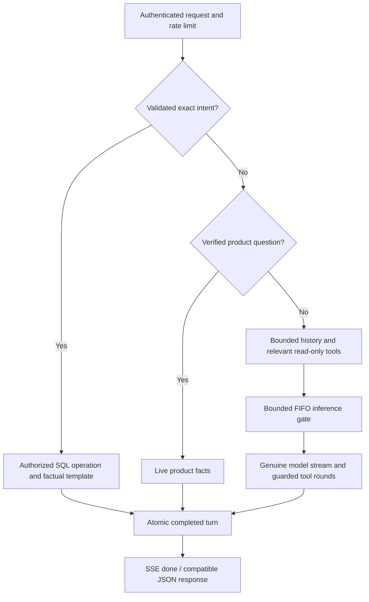

# AI architecture implementation and review report

27 November 2026. This phase is **for review only**: it has not been merged or deployed. The public deployment, its database, authentication configuration and instance size have not been replaced. Brief EC2 experiments ran candidate Python in a separate process with synthetic data and a new SQLite database under `/tmp`; they did not start a listener or change production code/configuration. The original dirty working tree was preserved.

## 1. Branch and commits

Repository: `Zayden369/trustshare-secure-file-sharing`. Branch: `optimization/ai-performance-architecture`, based on `8e7aa3be9b5681f4a0f3206de29ec99ac5227d0c`.

Implementation commits: `55aa997` (audit/tracing), `0c6ef1f` (hybrid assistant/SSE), `59c7f59` (authorization, retries and transport hardening), `bd74b87d2effba685f35c616e89bcbbb13d693f0` (summary jobs, recovery and fidelity), and `33cb5e50914500c8094089d3fc8bb61130345247` (validation/report). The review PR exposes the current head, including documentation-only link updates. Run `git rev-parse HEAD` after checkout to pin a reproduction.

## 2. Root causes and source references

- [Original audit](AI_ARCHITECTURE_AUDIT.md): known questions unnecessarily invoked a planner, a reply and sometimes a title model. The measured new-conversation storage query took **55.176 s and three LLM calls**; an existing-conversation session query took **8.252 s and two calls**. These are two exploratory deployed-engine samples, excluding HTTP/JWT, not a reliable baseline p95.
- [Chat engine](../server/src/assistant/chat_service.py): old history was not supplied; tool schemas/context were excessive; completion and cancellation lacked durable turn identity. Conversation titles added synchronous inference.
- [Functions](../server/src/assistant/functions.py): Python filtered already-loaded file rows; largest-file ordering/calendar-month semantics were absent; historical sessions appeared active; metadata authorization was not enforced by the executor.
- [Transport](../server/src/assistant/llm_client.py) and [client hook](../client/src/features/assistant/hooks/useChat.js): old Stop did not abort inference; whole-response rendering could not deliver real tokens.
- [Summary service](../server/src/file_summaries/service.py): no durable generation lease/policy identity, stale-job recovery or per-stage measurements; forced regeneration could obscure a prior result. Bulk file deletion also needed to remove new job/revision metadata before SQLite ID reuse.
- [Extraction](../server/src/file_summaries/text_extraction.py): DOCX/PPTX table text was omitted. Supporting-point selection dropped short table rows and important outcomes/caveats.
- Small CPU models are imperfect: baseline model outputs invented quantities and changed Hindi into Chinese. Faster output is not proof of better factual accuracy.

## 3. Architecture



Ten known intents bypass the model. Custom questions still use the configured assistant model; this is not a replacement by keyword-generated AI answers. Exact aliases are conservative: negations, extra clauses and ambiguous questions remain custom AI. Admin-curated custom labels can reference an existing registered intent through an admin-only endpoint. Clients cannot select arbitrary functions or supply ownership IDs.

## 4. Files modified

The authoritative list is `git diff --name-status 8e7aa3b...HEAD`. Main groups:

| Area | Files |
|---|---|
| Common | `server/src/ai_metrics.py`, `ai_auth.py`, `ai_scheduler.py`, `api.py` |
| Assistant | `assistant/{chat_service,controller,admin_controller,functions,intents,knowledge,llm_client,models,conversation_service}.py`, `assistant/seed/seed_configs.py` |
| Additive data | `entities/{chat_turn,assistant_suggested_query,summary_job}.py`, `database/init_db.py` |
| Summaries/files | `file_summaries/{jobs,service,providers,controller,models,text_extraction}.py`, `files/service.py` |
| Client/proxy | assistant API/hook/components/page, summary API/hook/panel, shared `utils/api.js`, `client/nginx.conf` |
| Validation | AI architecture/transport/PostgreSQL/summary job tests, frontend transport/hook tests, synthetic corpus and benchmark scripts |
| Documentation/config | this report, original audit, `docs/ai-review/*`, `server/.env.example` |

No homepage, animation system, global design tokens or unrelated feature redesign was performed.

## 5. Existing optimizations retained

The dedicated summary override `qwen2.5:0.5b`, assistant `qwen2.5:1.5b`, two summary threads, compact single-field structured generation, output ceilings, repetition control, long-input deduplication/span excerpts, in-memory authorized decryption, checksum/version/length/format cache key, permission rechecks, labelled extractive fallback and rate limits are retained. They are not claimed as newly invented here. No paid AI provider or larger instance was adopted.

## 6. New optimizations and reliability changes

- Live SQL count/filter/sort/limit, UTC calendar-month boundaries, grouped storage queries and valid current-session filtering. Result limits are bounded even if an admin sets a negative limit.
- Immediate titles without inference. Recent bounded history, relevant tool selection, compact default prompt, preserved custom admin prompt and selective product grounding.
- One shared engine for JSON and SSE. Actual Ollama NDJSON/OpenAI SSE chunks; AbortController and upstream response cleanup; no artificial typewriter replay. Incomplete streams are errors.
- Overall custom-turn deadline, bounded queue, at most five model rounds/six unique tool signatures; repeated tool calls stop. Private result payloads are redacted and bounded before model use.
- Durable request IDs, same-request replay, one active turn per conversation, retry leases and fenced completion. Stale workers cannot overwrite a newer retry. Partial cancelled assistant output is not persisted.
- Additive summary job/revision tables, policy-aware invalidation (`summary-policy-v5`), single-worker claims, duplicate rejection, interrupted-job recovery, prior-result snapshots, source/access rechecks before save, real phases and reconnect/resume UI.
- Source-order Office table extraction; numeric/caveat-aware supporting highlights for all native-model output formats. Supporting highlights are verbatim extraction, while the main native-model paragraph/bullets remain generated text.
- Malformed output, unsupported numeric quantities and major source-script mismatch are rejected. This is conservative validation, **not semantic proof of every generated claim**. The existing labelled fallback handles provider rejection.
- Pooled synchronous provider connections and a reused async client across tool rounds. No plaintext extraction cache was added; document bytes/text are not newly persisted or logged. Job generation snapshots are saved just before the final commit; end-to-end HTTP timings include transport and polling, and final trace logs include commit overhead.

## 7. Before/after latency

Different environments/scopes are kept separate. Small sample p95 is the nearest-rank order statistic, not a service-level guarantee. All candidate inference used synthetic documents and locally hosted Ollama.

| Measurement | N | p50 | p95 | Maximum |
|---|---:|---:|---:|---:|
| Local HTTP predefined questions | 20 | 0.341 s | 0.429 s | 0.465 s |
| Local HTTP verified product facts | 3 | 0.322 s | 0.340 s | 0.340 s |
| Local HTTP genuine custom AI, including first observed load | 4 | 3.149 s | 8.192 s | 8.192 s |
| Local HTTP fresh summaries, six length/format combinations | 6 | 6.213 s | 7.752 s | 7.752 s |
| EC2 isolated candidate predefined engine | 20 | 0.0359 s | 0.0532 s | 0.0929 s |

The deployed old storage/session engine samples were **55.176/8.252 s**. Candidate known queries eliminate inference rather than reducing its timeout. Local HTTP includes auth, persistence, transport and summary polling; EC2 engine timings exclude HTTP/JWT. Do not compare them as identical network tests.

Final local fresh results:

| Length | Paragraph | Bullet points |
|---|---:|---:|
| Short | 7.752 s | 5.274 s |
| Standard | 6.398 s | 6.028 s |
| Detailed | 5.308 s | 6.888 s |

These lengths do not imply monotonically increasing time: source/model output differs. No cached or fallback response is counted in this fresh-AI table; all six returned `ollama`.

Cached-summary HTTP recheck: **54.1 ms and 43.4 ms over IPv4 loopback**, with zero inference. The same result took **2.116 s through `localhost`** on this Windows client; server tracing measured about **32 ms**. The original complete benchmark's 2.053 s cached result is retained, not hidden. This is connection-path overhead, not model work. Use `127.0.0.1` for repeatable CLI benchmarks; this does not change OAuth redirect origins.

EC2 final direct-engine summaries were **3.164/3.203/3.766 s** for short/standard/detailed. These exclude decryption, extraction, HTTP and polling. They must not be represented as whole-document browser latency.

Raw artifacts: [local HTTP](ai-review/local-http-benchmark.json), [cache recheck](ai-review/cache-recheck.json), [EC2 engine](ai-review/aws-engine-benchmark.json), [earlier EC2 run](ai-review/aws-engine-before-final-grounding.json).

## 8. LLM calls eliminated

Every predefined/verified knowledge request: **zero model calls** (asserted by tests that forbid initializing the model). Old measured storage/session requests made three/two calls. New titles make zero calls. Ordinary custom explanations use one native inference; a custom tool question may require multiple rounds. Cached summaries make zero calls; a fresh successful native summary makes one, excluding explicit user regeneration.

## 9. Cold versus warm

Native timings distinguish model loading, prompt evaluation and generation. In the complete local run, the first assistant call reported **3.251 s model load**, **5.672 s first meaningful text**, **8.192 s completion**. Subsequent calls reported **7.6–9.3 ms load**, first text **0.461–0.590 s**, completion **2.527–3.229 s**. This is observed cold/loading versus warm behavior, not a controlled inference-daemon reboot experiment.

The first summary reported **1.955 s model load**; later loads were **8–35 ms**. The old baseline endpoint cannot split loading from prompt evaluation: its 44.816 s first inference is not labelled entirely as model load.

On EC2, an earlier cold assistant call reported **7.111 s load** and 16.515 s completion. In the final repeat one generic explanation finished in **7.848 s**, first text 1.026 s; another finished in **10.147 s**, first text 7.868 s. Prefix/prompt evaluation and CPU throughput still matter. A ten-second universal guarantee has not been achieved.

## 10. Assistant quality

All ten predefined intents are tested against authorized live handlers, including SQL ordering, exact calendar month, active sessions, account boundaries, disabled functions and admin requirements. Contradictory/stale intent IDs are rejected. Generic explanations remain genuine model responses. Verified knowledge states server-side encryption accurately and does not invent E2EE/zero-knowledge or screenshot-prevention guarantees.

The synthetic checksum/revocation explanations were relevant, but not every analogy was ideal. Complex tool use remains imperfect: one EC2 custom comparison correctly invoked `list_files` but did not retrieve every requested storage detail (41.293 s); another model output used invalid arguments and was safely rejected (14.068 s), with no invented account result saved. This is a remaining capability/latency limitation, not a passing accuracy result. No silent argument repair or unsafe fallback operation was introduced.

## 11. Summary quality

[Corpus](../server/tests/ai_evaluation.json) contains Cedar, botany, table, malicious-instruction and Hindi documents. The model comparison uses five case/length pairs across four distinct documents; botany is exercised by the HTTP combinations.

For the existing 0.5b summary model, combined main-text-plus-source-highlight checks improved **14/20 to 20/20**. Main generated narratives alone covered **12/20** in the final sample. This distinction matters: source highlights carry omitted facts; the main narrative did not suddenly become complete. All final HTTP standard/detailed cases included the tested critical facts in combined displayed output; short summaries intentionally omit details.

The 1.5b comparison was not consistently better. Two candidate outputs were rejected by fidelity validation; actual service requests would use the labelled fallback. Baseline 1.5b Cedar outputs introduced `46/357` quantities not in the source, and Hindi became Chinese. No larger/smaller assistant model switch was adopted. The existing 0.5b summary override remains, with stronger evidence and validation.

No tested generated narrative emitted the injection marker. This is a small corpus test, not proof of immunity to prompt injection. Numeric checks and script checks do not detect every semantic error. Requested 130–180-word detailed narratives were often compressed to fewer words; source highlights expanded coverage. **Detailed narrative length and perfect semantic faithfulness remain unmet quality targets.** Do not use a summary as an authoritative legal/security conclusion.

Raw [model evaluation](ai-review/model-quality.json) includes actual generated texts, rejected results, word counts, coverage and timings. It contains only synthetic material.

## 12. Concurrency

One active inference slot with at most four FIFO waiters protects the existing single-worker CPU workload. Database/knowledge answers bypass the gate. In a real local concurrent summary/data-query test, the data answer took **0.297 s** while the fresh summary took **3.194 s**. PostgreSQL tests verify one active conversation turn, one same-ID request, a single failed-turn retry claim, one summary generation, one forced-regeneration snapshot and one provider invocation across duplicate workers.

The gate is process-local. Multiple backend workers/instances require a shared queue/semaphore before scaling out. Saturated inference rejects or times out with a visible error; it does not run an unbounded hidden queue. Summary work remains in-process background work, with stale-job recovery rather than a durable external worker service.

## 13. CPU, memory, database and credits

Existing EC2: t3.medium, two vCPUs (one core/two threads), about **3.8 GiB RAM**, one backend worker. A read-only post-test snapshot showed backend **106.9 MiB / 768 MiB** and idle Ollama **86.64 MiB / 2 GiB**. Host memory snapshot: 3,832 MiB total, 793 MiB used, 3,038 MiB available, 241 MiB swap used. These are snapshots, not peak loaded-model measurements.

Earlier local observations: review backend roughly 94–105 MiB idle; loaded 0.5b model reported 486,067,403 bytes with no GPU allocation. Docker's local VM limit was 7.581 GiB; the host has 10 physical/12 logical cores. Local and EC2 timings are not hardware-equivalent.

Read-only [CloudWatch sample](ai-review/aws-resources.json): credit balance **575.465–576**, surplus balance **0**. Five-minute CPU averages were mostly 1.4–1.6%, one 11.67% bucket, maximum observed minute 40.01%. This preceding observation window does not establish peak inference CPU; it does rule out depleted credits during that sample. No sustained under-load host profiler was installed.

[PostgreSQL plans](ai-review/query-plans.json) on 2,001 synthetic file rows executed owner-scoped largest/recent/grouped-storage queries in **1.246/0.696/0.748 ms**. Plans use a sequential scan and top-N sort/aggregation at this size. There is no existing owner index on `files`; no speculative production index or DDL change was applied. At larger/multi-tenant volumes, measure a partial `(owner_id, size DESC, id DESC)` and/or recent-file index before adopting it. SQL filtering/limiting already avoids materializing every file into Python.

## 14. Automated tests

- **147 backend tests passed**, covering AI routes/transport/jobs, existing summary tests, registration verification, MFA delivery policy/auth regressions and share archive. After adding the missing deadline seed, **29 affected AI tests passed** again.
- **7 actual PostgreSQL checks passed** using validated disposable schemas, including concurrent claims and query plans. Existing application tables were not modified by these tests.
- **13 focused frontend tests passed** across four suites: actual partial tokens, AbortSignal, duplicate clicks, stable request retry, conversation switch, fragmented SSE/EOF handling, summary reload/recovery and panel options.
- Full frontend: **88 passed, nine failed, one additional suite failed to load**. Untouched base with the same dependencies: **79 passed, the same nine failed and same suite-loading error**. Failures are in FileDragDrop, Notifications, Activity, Sharing and NavbarNotifications; the latter hits pre-existing `react-markdown` ESM/Jest configuration. These were compared directly, not guessed to be pre-existing. No new full-suite failures appeared. The full frontend suite is **not green**.
- Docker stopped during one late local run. That partial run is excluded. Docker and the normal local services were restored, and the final sequential benchmark completed. This was not reported as a successful completed sample.

## 15. Build and browser results

The final React production build **passed with warnings**, including existing lint/bundle-size warnings. Python modules were compiled/tested in the real backend dependency environment.

In the ChatGPT in-app browser, a separate `localhost:3011` synthetic admin session demonstrated live storage results, progressively streamed model text, Stop, reload without persisted partial assistant output, a fresh Ollama summary with actual delivery timing, and regeneration. Standard UI styles remained intact. The final built synthetic member page also showed no admin controls, recovered an actually interrupted job through Try again (3.42 s), and restored that cached result on reopen (0.09 s). There was no exhaustive visual walkthrough of every unrelated member/admin feature in this phase.

Screenshots: [instant data](ai-review/instant-data.jpg), [streaming](ai-review/streaming.jpg), [cancelled](ai-review/cancelled.jpg), [processing](ai-review/fresh-summary-processing.jpg), [fresh result](ai-review/fresh-summary.jpg). The early fresh-result capture preceded the final evidence-selection refinement; it is interaction evidence, not the final quality score. Final-build screenshots show [member recovery](ai-review/member-recovery-final.jpg) and [cached restoration](ai-review/cached-member-final.jpg).

## 16. Security regressions

AI HTTP endpoints require authentication. Existing login/MFA/registration code was not replaced. AI auth timing wraps the existing dependency; session revocation is rechecked before tool execution/final persistence and periodically during token delivery. A revoked-session test confirms no completed assistant reply is saved. Authorization/limits apply to deterministic and model-selected operations alike.

Summary read/write/revision routes re-authorize the file. Revoked shares, inactive users, changed source version/checksum, late workers and cross-account IDs cannot retrieve/save unauthorized results. Existing encryption, checksum verification and file access paths remain. Bulk deletion explicitly removes derived job/revision metadata.

No real document/account data was sent to an external provider. External AI stays opt-in; external account context requires its own explicit setting. Timings log no SQL text/parameters, filenames, emails, prompt bodies, document text, tokens, keys or provider response bodies. Error bodies are generic. SSE uses the shared authenticated fetch adapter and existing token refresh flow; there is no new token in a URL. The model never executes shell commands or arbitrary function names.

## 17. Known limitations

This is review-ready development, not an unconditional production-performance sign-off. Small-model semantic errors, incomplete long narratives, custom tool-selection failures, limited language/script validation, CPU cold starts and the pre-existing frontend suite failures remain. Stream revocation checks happen at engine boundaries/roughly two-second token checkpoints, not as an instantaneous push from logout. Delayed upstream output is still bounded by HTTP/overall deadlines.

Summary history is additive; legacy cached completed results remain readable until explicitly regenerated. Policy hashes apply to tracked new jobs and an explicit model-revision override; a provider changing the same tag without a revision bump is not automatically detected. Summary revisions retain prior derived summaries as database records; no new plaintext document extraction cache is retained.

## 18. Remaining bottlenecks and next actions

The CPU's model load/prefill/generation dominates difficult AI requests. Large tool schemas and multiple reasoning rounds can exceed ten seconds. Further safe work is a larger representative answer-quality set, targeted tool/schema/model comparisons and deployment-environment HTTP/load testing. Do not mask this with a ten-second timeout, label extraction as AI, or promise a larger instance/paid model without a separately authorized choice. If multiple workers are introduced, replace the process-local gate first.

## 19. Configuration and rollout notes

New additive DB tables: `assistant_chat_turns`, `assistant_suggestion_intents`, `summary_jobs`, `summary_revisions`. Startup `create_all` creates them; no existing table column was dropped. The conversation partial unique index supports SQLite and PostgreSQL. Rollout should first back up the database and verify these additions on staging.

`AI_REQUEST_DEADLINE_SECONDS` is an editable seeded assistant config, default 75, clamped 10–120; existing admin values/prompts remain untouched. Optional `ASSISTANT_OLLAMA_THREADS` defaults to automatic (0); the preview/EC2 experiments capped it at two. Summary thread/model override, input cap and revision variables are documented in `.env.example`. Current gate: active 1, waiting 4; custom queue timeout up to 20 s, summary queue timeout 30 s. Stale summary recovery threshold 300 s; interrupted assistant retry threshold 180 s; fallback provider retry backoff 120 s.

Keep `ALLOW_EXTERNAL_AI=false` and `ALLOW_EXTERNAL_ACCOUNT_AI=false` for local-only processing. Assistant model selection remains in the existing admin DB configuration. Do not blindly replace a working SMTP/OAuth/secret `.env` with the example.

The checked-in client nginx exact SSE location disables proxy buffering/cache/compression and sets a 135 s read timeout. An eventual production rollout must verify every outer proxy/CDN also forwards chunks. Example nginx outer location:

```nginx
location = /api/assistant/chat/stream {
    proxy_pass http://backend:8000;
    proxy_http_version 1.1;
    proxy_buffering off;
    proxy_cache off;
    gzip off;
    proxy_set_header Connection "";
    proxy_read_timeout 135s;
}
```

Do not paste a second web-server configuration into a running server without adapting its existing upstream and TLS setup. No production proxy has been changed here.

## 20. Rollback

No production rollback is currently required because this phase is undeployed. If later authorized, retain the previous application images/release and DB backup; roll back application images/config together. The previous code can ignore the four additive tables. Do not drop them or delete file/user rows to roll back code. Preserve completed summaries and revisions. Rollback does not require rotating SMTP/OAuth/master keys. Discard only explicitly isolated test containers/databases when finished; never use a global Docker volume prune.

## 21. Pull request

Review PR is linked in [AI_REVIEW_LINKS.md](AI_REVIEW_LINKS.md). Logical commits are kept in one review branch to avoid interdependent stacked merges. **No auto-merge or deployment is enabled.** Springboard upstream has not been pushed.

## 22. Local reproduction

Existing isolated preview: `http://localhost:3011`, API `http://127.0.0.1:8011`. Synthetic credentials remain in the local runtime directory outside Git; no password is in this report. The usual app remains at port 3000. Keep Docker and the existing local Ollama service running.

For a new machine, follow the repository README for dependencies/database/encryption secrets and run this branch locally; use the existing Admin AI settings to enable Ollama and select the installed assistant model. Use an isolated test DB and synthetic users/documents for benchmarks. The assistant and summary model names are independent.

```powershell
git switch optimization/ai-performance-architecture
# In project-root/client, with the repository's installed dependencies:
$env:CI='true'
npm test -- --watchAll=false --runInBand --runTestsByPath src/features/assistant/hooks/useChat.test.js src/features/assistant/services/assistantAPI.test.js src/features/fileSummary/hooks/useFileSummary.test.js src/features/fileSummary/components/FileSummaryPanel.test.js
npm run build
```

Inside the backend dependency environment, from `project-root/server`:

```bash
PYTHONPATH=. python -m pytest tests/test_ai_architecture.py tests/test_ai_transport.py tests/test_summary_jobs.py tests/test_file_summaries.py tests/test_summary_recovery.py tests/test_registration_verification.py tests/test_mfa_delivery_policy.py tests/auth_regression tests/test_share_archive.py -q
python scripts/benchmark_ai.py --url http://127.0.0.1:8011 --credentials /path/to/SYNTHETIC-credentials.json --output /tmp/local-ai-results.json
PYTHONPATH=. python scripts/evaluate_ai_models.py --url http://host.docker.internal:11434 --model qwen2.5:0.5b --output /tmp/quality.json
```

For actual PostgreSQL races, set `RUN_TEST_AI_POSTGRES=1` and `TEST_POSTGRES_URL` to a **local test PostgreSQL** credential allowed to create/drop a disposable `ts_ai_test_*` schema. Run `tests/test_ai_concurrency_postgres.py`; never point an arbitrary fixture at production. The isolated engine benchmark script refuses an existing output directory and forces its own new SQLite database under `/tmp/ts_ai_bench_*` before application imports.

Browser check: select a suggestion; confirm one factual response, then ask a custom explanation and observe partial text/Stop. Switch conversation or reload after stopping; verify no partial assistant result is saved. Generate distinct synthetic files across lengths/formats, reopen to restore cache/job state, regenerate and inspect Earlier summaries. Compare a member's result with an admin's and attempt a cross-account file ID; access must remain denied. No live Google/SMTP setup change is needed to test this phase.
