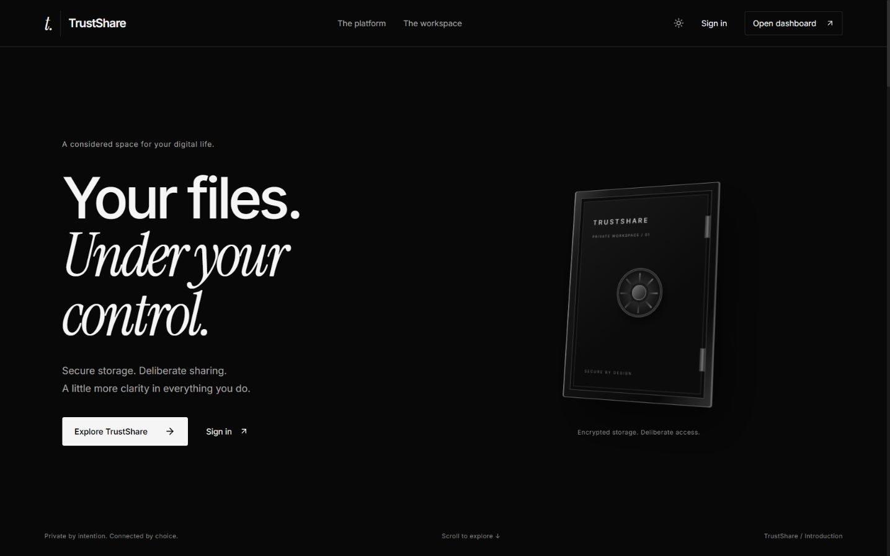
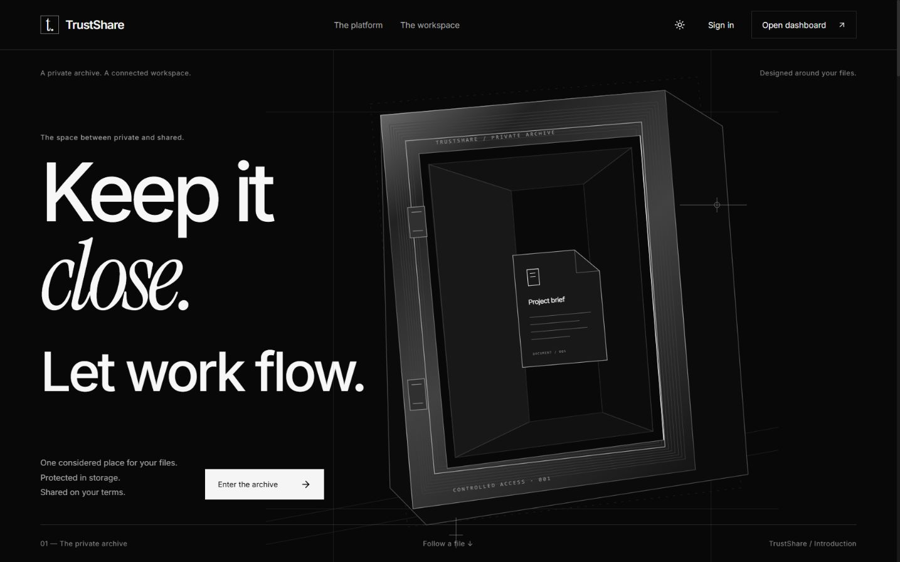
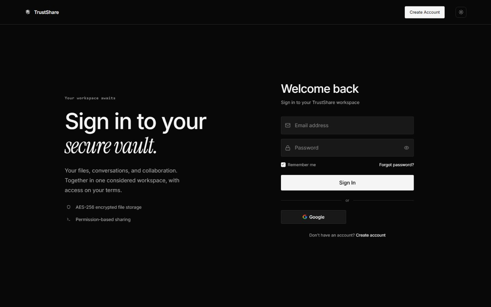
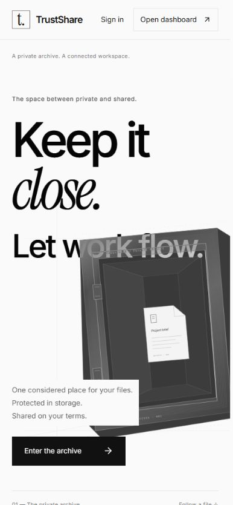
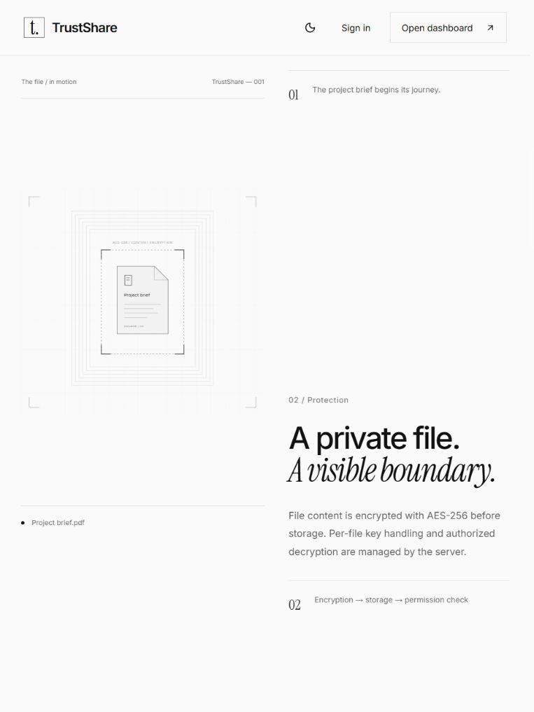
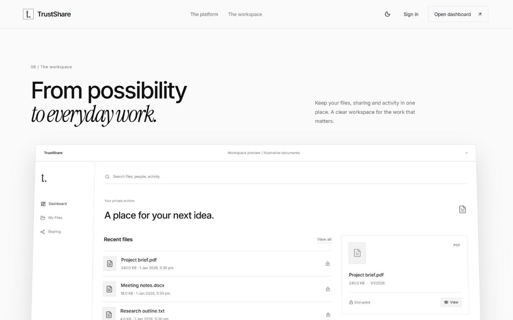
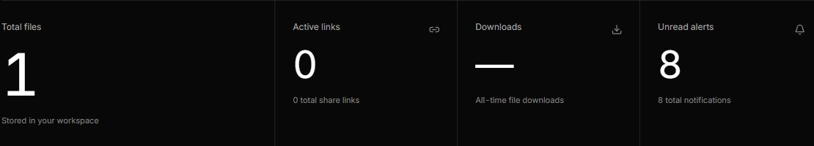

# TrustShare / editorial experience

Review branch: `codex/trustshare-editorial-experience`, based on `3ec619d`. Existing local backend, upload, OAuth and deployment changes are outside this review.

## Audit and art direction

Both supplied recordings were sampled locally. WAYNE CITADEL informed large sans-serif and italic serif contrasts, machined edges and restrained technical diagrams. The portfolio was inspected interactively in the ChatGPT browser: layered type, offset columns, compact sticky navigation and progressive text emphasis were observable. Its colors, imagery and content are not reused.

The current recording exposed an empty viewport during login navigation, large loading placeholders, a detached small safe, and a product preview dominated by empty metrics. This does not establish a backend cause for the navigation delay. Improve initial HTML presentation without changing authentication or requests.

Direction: **a private archive, precisely engineered**. An architectural aperture and one document connect the introduction, explanatory diagrams and authentication. Large type crosses the aperture's edge; application pages use compact ruled sections. Instrument Serif is reserved for editorial accents; Inter remains the UI family. Existing semantic dark/light tokens remain authoritative.

## Sequence and boundaries

Audit → art direction → browser-reviewed proof (hero, file-to-protection, Dashboard, My Files) → complete landing → authentication and shell → responsive/theme/motion/regression QA.

Keep API calls, authentication handlers, permission checks, upload/download handlers, calculations and schemas unchanged. Public illustrative documents must be identified as examples; account metrics remain real. No merge or deployment is part of this change.

QA evidence and limitations will be appended after verification. Private account screenshots and supplied reference frames remain local under `tmp/editorial-review` and must not be published in a public PR.

## Presentation architecture

- `ArchiveArtwork` draws a custom recessed aperture with layered metal edges, structural annotations and the document that appears in the story. It is SVG, not a downloaded model or a new rendering dependency.
- `ArchiveJourney` keeps one document in a bounded sticky stage. Arrival, protection, connection, organization and perspective each have their own target and normalized `useScroll` progress. The document never fades out. Boundary, pathways and collection layers respond directly to position, so they can reconstruct earlier states when scrolling upward. Ordinary browser scrolling and anchors are retained.
- Hero pointer depth uses bounded motion values and springs, independently of the hero's scroll scale. There is no scroll hijacking or long entrance timeline to replay on fast scrolling.
- The particle formation remains one conceptual moment. Counts are capped at 1,800 desktop, 800 on low-core devices and 450 on narrow devices; DPR is capped at 1.5. IntersectionObserver pauses off-screen animation. Reduced motion renders a static formation. Progress is initialized from its current value, including refresh in the middle of the scene.
- `WorkspacePreview` reuses the live `RecentFilesPanel` and `FileCard`, with explicitly illustrative documents. It makes no API request and does not expose account data. Its inert visual controls cannot be mistaken for a second working application; the live-workspace link sits outside the preview.
- Authentication shares `AuthArtwork`, with all existing submit, validation, OAuth, OTP and resend handlers retained. The form remains the primary interactive surface.
- `BootScreen` replaces plain loading text; initial HTML also contains a visible opening state before the JavaScript bundle starts. This improves feedback, without claiming to reduce backend latency.

## Tokens and styling ownership

The semantic palette stays in `src/styles/tokens.css`: dark background `#080808`, light background `#fafafa`, contrasting text/accent, neutral surface/border/text tiers, Inter for controls and Instrument Serif for editorial accents. Motion timings remain short for application feedback and longer only for editorial composition.

`styles/experience.css` now contains the global focus and reduced-motion foundation, rather than a body-selector override stack. Sidebar, Navbar, PageContainer and PageHeader own their presentation. My Files rules moved out of `assets/global.css` into `features/myFiles/my-files.css`; modal, selection, drag-and-drop and list classes are retained. Dashboard owns its ruled metrics, file rows, actions and compact loading layout. Analytics and Assistant aliases refer to the shared tokens in their existing stylesheets.

Sharing/Admin statistics, notification/activity rows and Settings sections use the same typography, compact controls and ruled grouping. Existing analytics series patterns, chart data sources and calculations are retained.

## Evidence and validation

The first proof was built and inspected in the ChatGPT in-app browser at 1440×900 before extending the design to authentication and the remaining screens. Local captures cover the hero, file arrival, protection boundary, Dashboard, My Files root, an existing folder and its file card. That review identified and corrected search positioning and legacy icon-color conflicts.

An AST comparison against the captured working-tree baseline verified **46 authentication and file-action handlers unchanged**, including the pre-existing uncommitted OTP resend behavior. That behavior is excluded from this UI review's commit.

Final responsive screenshots, route checks, build output and regression results are recorded below after the final browser pass.

## Existing limitations kept outside this change

- The local Dashboard response currently omits `total_downloads`; the existing fallback remains visible. This UI review does not invent a zero or change analytics contracts.
- The local assistant reports that its API key is not configured. Its drawer and page render, but this review cannot demonstrate a model response without changing runtime configuration.
- Data-loading duration is unchanged. The loading presentation is smaller and the application no longer fades its entire page on each route change.
- The preceding branch had 12 failing tests across six suites (stale expectations/mocks, a missing sharing export and the Jest ESM configuration for `react-markdown`). Final results are compared with that baseline, rather than described as an entirely passing suite.
- Live provider consent, mailbox delivery and destructive/admin mutations are not part of a visual regression pass. The existing session and data are preserved.
- The browser automation surface does not advertise a recording API. Native screenshots provide the walkthrough evidence; no still-image sequence is represented as a real-time motion recording.

The browser refresh check found a UI cause of unexpected jumps: the existing `ScrollToTop` reset every initial mount, then repeated that reset after 50 ms. It now skips initial mount and same-path anchors, and resets only on a different pathname. Because the landing route is lazy-loaded, `useInitialScrollRestoration` also retains the per-tab viewport position in session storage on page hide. On a reload, it waits for the document to be ready and tall enough before restoring that position. New navigation, user interaction or a ten-second deadline cancels the pending restoration; observers and animation frames are cleaned up. The browser check retained the exact position, 1433.5999755859375 px, before and after reload in the protection chapter. Focused tests cover Strict Mode, route/hash navigation and deferred restoration after lazy content arrives.

## Final browser review

All review interactions used the ChatGPT in-app browser against the local Docker frontend. The final optimized bundle was copied into the existing frontend build mount; the backend and database were not restarted or changed.

| Area | Checks performed |
| --- | --- |
| Public introduction | 390, 768, 1024, 1440 and 1920 px widths; dark/light themes; hero composition; native section anchors; slow, incremental, fast and reverse scrolling; reload within the story; closing document motif |
| Dashboard | Actual account metrics and file rows at 1440 and 390 px; compact loading; sidebar collapse/expand; mobile drawer navigation |
| My Files | Root, existing folder and file card; grid and list presentation; search/filter/sort controls; selection and cancellation; mobile layout and version-history dialog |
| Authentication | Empty login forms in both themes and at mobile/desktop widths; signup progression without submission; recovery and OTP presentation |
| Other application routes | Sharing, Shared with Me, Activity, Notifications, Analytics, Admin, Settings profile/security, assistant drawer and full assistant page at desktop width |

The final 390 px version-history check confirmed that the filename truncates inside the header, the New Version control moves onto its own row, and the active version number has visible contrast. No upload, restore, delete or historical download was triggered. Existing folder navigation and the original dark theme were restored afterwards. The final landing tab reported no captured console errors.

The available authenticated review session was an administrator. A separate member session was not used for this visual pass; member-only permission outcomes are not claimed as verified. No account credentials, consent settings, messages, files or server configuration were changed.

## Build, tests and behavior guardrails

- **Production build:** completed successfully with `GENERATE_SOURCEMAP=false` and `BUILD_PATH=build-verified`. Main JavaScript is 569.18 kB gzip; main CSS is 44.87 kB. The lazy landing chunk is 9.97 kB JavaScript plus 3.04 kB CSS.
- **Build warnings:** existing effect-dependency warnings in My Files, Version History and Settings, and unused Settings icon imports. The existing large-main-bundle advisory remains. These are reported rather than changing business effects within a visual review.
- **Full working-tree test run:** 59 passed, 12 failed, 71 total; 10 passing and six failing suites. The same 12 baseline failures concern stale FileDragDrop, Notifications, PublicShare and Activity expectations; a Sharing service mock/export mismatch; and the NavbarNotifications Jest ESM setup for `react-markdown`. Existing unrelated local tests are included in these working-tree totals.
- **Final focused regression run:** 23 tests passed across Landing, layout and ScrollToTop suites, including the lazy-content restoration follow-up. The last dialog and particle-resize refinements were subsequently checked by production build and browser inspection.
- **Staged source audit:** 59 authentication, file, version-history and Settings handler bodies match base commit `3ec619d`. Staged scope and credential-pattern checks passed. This guard complements browser checks; it does not assert that every external integration was exercised.
- No dependency, API, schema, role, metric calculation or backend changes are included. Pre-existing local OAuth, upload, SMTP, notification and deployment work remains outside this commit, including the pre-existing OTP resend handler change.

## Before and after

These public review images contain either empty forms, conceptual/illustrative documents or a crop of aggregate metrics. Full private account captures stay local and are excluded from Git.

| Before | After |
| --- | --- |
|  |  |
|  |  |

## Remaining UI improvements

Further route-level splitting could reduce the large shared bundle. Legacy dialogs would benefit from a dedicated accessibility pass covering focus containment, restoration and keyboard behavior across every modal. Assistant/provider response states should receive a separate functional review when runtime keys and provider sessions are available. None of these items justifies silently altering existing behavior in this presentation change.

This branch is a stacked draft review over `codex/trustshare-monochrome`. It has not been merged or deployed. Framer was not required, and no Framer project was published or changed.
