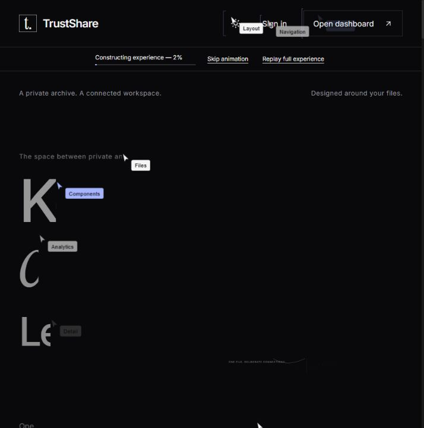
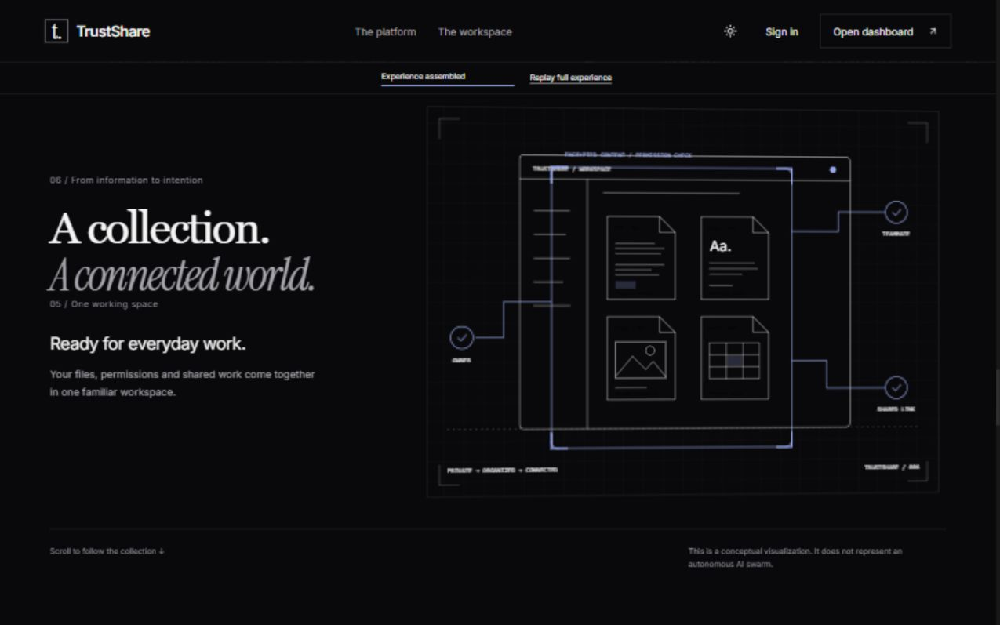
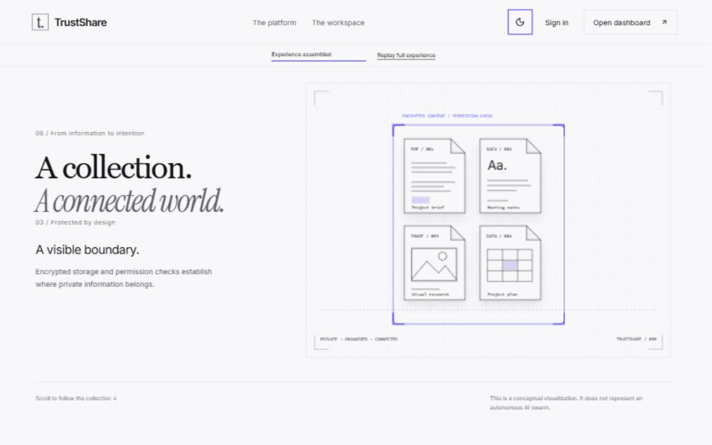
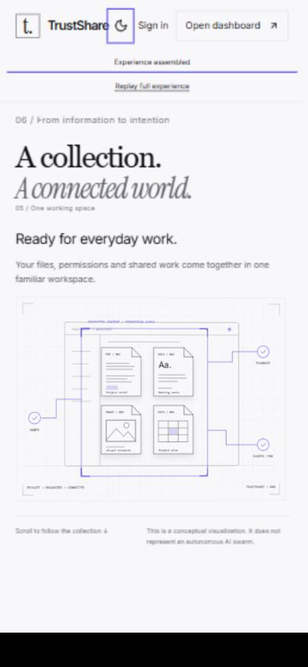
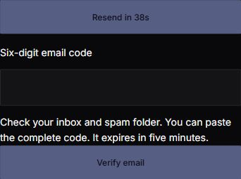

# Final homepage refinement and registration verification

Review date: 26 November 2026. Branch: `codex/final-construction-email-verification`, stacked on `codex/living-archive-phase-two` (PR #4). This change is for review. It is not merged or deployed to AWS. Existing local OAuth/MFA corrections needed for this authentication audit are incorporated; unrelated local Docker, upload and AI changes remain outside this commit.

## Public homepage

`PageConstruction` registers 64 existing visual targets across navigation, hero, the five file-journey chapters, cinematic sequence, workspace demonstration, product preview, closing CTA and footer. It assembles the existing page rather than substituting a new layout. Structural outlines, text masks and graphic reveals have separate durations and weights. Cursor positions track the reveal edges of assigned targets.

Sections activate monotonically when visible or passed, including a fast scroll to the footer. Each activated region has its own clock. Reverse scrolling and theme changes do not reset that clock. Progress counts the weights of **completed tasks**, not scroll distance or partial time. The footer activates all remaining tasks; it does not manufacture 100% completion. Ordinary regions finish in roughly 1–3 seconds after activation.

Cursor budgets are 24 desktop, 10 tablet, 6 mobile, and 12 on lower-core desktop devices, bounded further by visible unfinished work. Cursors do not intercept input. The compact controls occupy a separate sticky row beneath navigation, keeping the hero CTA clear rather than floating over it. Layout measurements occur on scroll/resize; frame updates use cached rectangles. Completed targets stop receiving style writes. The animation frame loop sleeps when there is no activated work left and resumes on scrolling. Reduced motion completes the page immediately.

**Replay full experience** cancels prior construction work, preserves theme and intentionally returns smoothly to the top before starting a new page timeline. **Skip animation** cancels pending replay and completes all targets. The original workspace demo remains an independent 13.5-second timeline with its original replay control. Full-page replay does not reset the workspace demo.

Browser observations: full replay reset all 64 targets; theme change retained construction state; End-key fast scrolling advanced from 22% to 36%, then completed remaining work naturally; completion and skip both left zero active cursors and zero unfinished targets. Workspace replay completed in **13,501 ms** by its activation/completion timestamps.



## Cinematic sequence

The former `ParticleFormation` wave sculpture is removed and replaced by `CinematicStory`. The existing Living Archive hero, earlier file journey, workspace preview, typography, palette and theme transition remain.

Four distinct document illustrations move continuously from independent positions into a collection. A protection boundary draws around them; permission-checked destinations connect; the collection resolves into a workspace shell. Scroll controls position, rotation, scale, boundaries and connection paths. Reversing scroll reverses the same scene, without generating a new animation instance. Reduced motion shows the resolved workspace. Only the active narrative chapter is exposed to assistive technology.

The supplied `Screen Recording 2026-11-25 203145.mp4` was found in Videos/Screen Recordings and inspected at twelve positions across its 23.83-second duration. Its connected diagrams and layered editorial panels informed the approach; its artwork was not copied.







## Session audit and fixes

The application has one selected account per browser storage context and one current server login session per account. It has no account-list/chooser architecture. No discovery of accounts from arbitrary stored profiles was added. A tab-only session takes precedence over a remembered session; explicit successful sign-in clears conflicting credentials. Remembered-account changes in another tab cause a fresh server validation.

`AuthContext` restores identity through `/api/auth/me`. A cached profile cannot establish authentication. The existing protected route waits while this check runs. The public Open dashboard links retain the existing `/dashboard` destination; they do not mint sessions or bypass the route guard. In the final local browser check, an existing account restored successfully and Open dashboard opened its workspace. My Files, Sharing, Analytics and Settings loaded with the restored session. These were read-only smoke checks, not a complete functional audit of those modules.

Previously, access tokens were not bound to a revocable session row. Production now refuses the known default, placeholder or undersized JWT signing key. New access tokens contain a digest binding to their current server refresh session, and both bearer and media-query authentication validate it. Logout, revocation and rotation invalidate the old access token as well as refresh reuse. Issuance and rotation serialize on the account row; rotation is committed with new-session creation. Persistence failure cannot return a usable new session.

Existing legacy access tokens without a binding receive 401. An existing **valid, current** refresh session can rotate into the new format automatically. Logged-out, revoked, expired and suspended sessions cannot upgrade. Refresh tokens retain their existing 30-day lifetime; access tokens retain their existing 60-minute lifetime. A valid session already established after MFA remains valid until expiry/revocation; merely opening the dashboard does not require a second MFA challenge.

The client shares a refresh request across simultaneous failures for the same token. Parallel callers both retry after rotation. A late response cannot resurrect a logged-out session or overwrite a newly selected account. Storage priority and clearing are consistent across password, registration and MFA completion.

Password and Google OAuth sign-in check the account's MFA setting before creating a session. OAuth exchanges store a short-lived, one-use identity reference, not session tokens. The Google callback now checks browser state and the actual v3 UserInfo `email_verified` claim before accepting ownership. SMTP failure is surfaced instead of silently preserving a usable MFA code. MFA codes are generated securely, are not logged, are single-use and have five verification attempts. Microsoft remains unavailable, as chosen for this launch; its Graph mail/UPN values cannot bypass ownership verification.

## Registration flow and API contract

1. `POST /api/auth/register/send-otp` accepts `{email}`. The maintained `email-validator` library normalizes and validates syntax, then checks DNS deliverability. Definite invalid domains and null MX records are rejected. Temporary DNS uncertainty is allowed through to mandatory mailbox verification, never treated as proof of ownership. Plus addresses and corporate domains are supported.
2. SMTP must accept delivery before a challenge is created. The response contains only `challenge_id`, `expires_in: 300` and `resend_after: 60`. It never returns a code. SMTP failure returns 503 in development and production.
3. `POST /api/auth/register/verify-otp` accepts `{challenge_id, code}`. Successful verification consumes the OTP and returns an opaque `verification_token`, normalized email and five-minute proof lifetime. A code can issue only one proof.
4. `POST /api/auth/signup` now requires that proof in addition to name, email and password. Account creation, proof consumption and verification evidence are part of the same database transaction. Direct signup, forged proof, email mismatch, expired proof, proof reuse and concurrent attempts are rejected. The account receives a normal session only after this check succeeds.

Registration codes are six digits from `secrets`, valid for five minutes, with HMAC-SHA256 digests bound to the registration purpose, challenge and email. Digests require a server secret of at least 32 characters. Proofs have 256 bits of randomness and are stored as SHA-256 digests. Neither raw codes nor raw proofs are persisted in verification tables or logged. Resends invalidate older codes and proofs after successful new delivery. Delivery budget reservation and generation checks prevent delayed SMTP sends from replacing newer challenges.

Persistent limits: 60 send requests per IP/hour (including invalid-address requests), 20 actual send attempts per IP/hour, 5 send attempts per email/hour, 60-second email cooldown, 5 wrong attempts per challenge, 10 wrong attempts per email/hour across resends, and 60 verification requests per IP/hour. SMTP failures consume the delivery budget. Request client addresses are used rather than trusting arbitrary forwarded headers. Behind a reverse proxy, configure the ASGI server to trust only that proxy; otherwise clients conservatively share the proxy's IP budget.

## Registration interface

The existing name → email → password presentation is preserved. The email step now requires server-confirmed verification. Its accessible, single six-digit field supports a complete pasted code, numeric mobile keyboards and one-time-code autocomplete. It displays inline failures, expiry guidance, resend cooldown and backend-confirmed success. Changing email removes client authorization; the server also binds authorization to the original normalized address. Returning between steps preserves a still-valid proof. Pending responses from unmounted email fields cannot restore stale authorization. Expired proof cannot create an account.

The live browser test confirmed that Continue cannot bypass verification, successful verification advances to the password step, reverse navigation preserves verification, and changing email requires verification again. A stale warning found during that check was removed and covered by a Signup regression test.



Successful browser verification was observed directly. The attempted success screenshot included account information and was excluded from public review assets; the privacy-safe OTP input screenshot is retained.

## Database changes and rollout

Three additive tables are registered through the existing `init_db` / `Base.metadata.create_all` startup path:

| Table | Purpose |
| --- | --- |
| `registration_challenges` | Email-bound code digest, expiry, attempts, consumed state and hashed proof |
| `registration_limits` | Durable hourly email/IP request, delivery and failure budgets |
| `verified_emails` | Verification evidence by user, email, method and timestamp |

Existing users and file/share/analytics tables are not rewritten. No historical user is blindly marked verified. Evidence is created after registration OTP or trusted Google verification; historical password accounts remain usable under the existing policy. Login MFA is a separate purpose and endpoint from registration verification.

On an eventual reviewed rollout, install requirements, configure secrets/SMTP, back up the database using the normal operational process, then restart one backend instance so the new tables are created before serving the new signup client. Do not change the master file-encryption key. Rolling back just the new frontend does not remove the backend's proof requirement. Roll back matching client/server versions together if needed; retain verification evidence and existing data.

Expired challenges older than one day are pruned on subsequent send requests. Rate-limit identities remain in the durable table and reset their counters after one hour; plan periodic retention maintenance for inactive rate rows in a long-running public service. No database purge was performed on existing application data.

## SMTP and OAuth configuration

Use `server/.env.example` as the reference. Keep real values in an ignored environment/secret store:

```dotenv
SMTP_HOST=smtp.gmail.com
SMTP_PORT=587
SMTP_USER=your-sender-address
SMTP_PASSWORD=your-provider-app-password
EMAIL_FROM=your-verified-sender-address
SECRET_KEY=your-existing-strong-jwt-secret
OTP_SIGNING_SECRET=an-independent-random-secret-of-at-least-32-characters
```

The current mail transport uses STARTTLS and certificate verification on port 587. For Gmail, use an app password on an account with two-step verification. Other providers need authorized sender/recipient settings; SES sandbox restrictions must be removed for general recipient delivery. The verification email includes branded HTML, a plain-text alternative, a prominent code, five-minute expiry, ignore-if-unrequested guidance and the product footer. There is no development delivery bypass or console OTP preview.

Google's configured redirect must continue to match the exact backend callback URL for that environment. The browser-state cookie is HttpOnly, SameSite=Lax, ten-minute lifetime and Secure when the frontend URL is HTTPS. No real OAuth secrets were committed. Microsoft app registration is still an external requirement before a future supported re-enable; no card/subscription signup was attempted.

## Verification evidence

| Check | Result |
| --- | --- |
| Isolated backend registration, SMTP/MFA, session and share regressions | **64 passed** |
| Real PostgreSQL concurrency, in disposable schemas | **4 passed**: concurrent signup, correct-code verification, refresh rotation, and transaction rollback |
| Focused frontend auth/motion tests | **29 passed**, 8 suites |
| Full frontend run before final small UI fix | **91 passed, 9 failed, 100 tests**; 19 suites passed, 5 failed |
| Production React build | Compiled successfully; existing large-main-bundle advisory remains |
| Browser | ChatGPT in-app browser only; desktop and 390px/320px widths, both themes, full replay/skip, reverse/fast scrolling, workspace replay, session restoration, real OTP verification |
| Live local registration | SMTP accepted; user received and supplied the code; ownership verified; controlled account created; proof replay **403**; access after logout **401** |
| Second live browser code | Verified successfully; advanced to password step; email change removed verification; no second account/password was created |

No codes, credentials, full email addresses, tokens or proofs are included in screenshots or saved public evidence. One controlled local test account was created with no files; its session was logged out. The separate browser-only verification challenge will expire normally.

The nine full-suite failures match the prior phase: FileDragDrop (3), Notifications (3), Activity (2), Sharing lifecycle classification (1), plus the NavbarNotifications suite's existing ESM setup failure. They were not expanded into unrelated fixes. The final focused run includes the additional stale-warning regression. Existing deprecation warnings remain in Python and React testing dependencies.

Reproduce focused frontend checks from `client`:

```sh
CI=true npm test -- --watchAll=false --runInBand --testPathPattern='Signup.test|RegistrationVerification|AuthContext|apiSession|Landing.test|pageConstructionSchedule|constructionSchedule|OAuthCallback'
GENERATE_SOURCEMAP=false npm run build
```

Run backend tests in a test environment with the repository on `PYTHONPATH`. These files create isolated SQLite databases and mock delivery; do not run the repository's unrelated global database-reset fixtures against real data:

```sh
python -m pytest --confcutdir=tests/auth_regression tests/auth_regression -q
# For the other isolated files, copy them to a temporary test directory outside
# tests/conftest.py's scope, with PYTHONPATH pointing to the server checkout.
python -m pytest /tmp/trustshare-check/test_registration_verification.py /tmp/trustshare-check/test_mfa_delivery_policy.py /tmp/trustshare-check/test_share_archive.py -q
# Optional: DATABASE_URL must point to a development/test PostgreSQL server.
RUN_TEST_POSTGRES=1 python -m pytest /tmp/trustshare-check/test_registration_concurrency_postgres.py -q
```

## Explicit limits

No AWS deployment, merge or Springboard push was performed. Browser video recordings were **not captured**: the available browser tooling exposes screenshots, not recording. The supplied inspiration video was inspected; that is not represented as a recording of this implementation. Screenshots and observed timing/state checks are included instead.

Google provider interaction and MFA gating were tested with isolated provider responses; a new real Google consent round trip was not performed in this phase. Real SMTP and registration ownership verification were tested. MFA's existing pending-code and OAuth exchange stores remain process-local, so a backend restart invalidates pending MFA/exchanges and multiple backend workers require shared state before scaling. Registration challenges and budgets are database-backed and survive new sessions/restarts.

Reduced motion was verified through the component test path; a live OS preference toggle and physical touch/low-end-device performance were not tested. Responsive checks used browser viewport overrides, reset afterward. Upload/download/encryption implementations, assistant, analytics calculation logic, file illustrations and inactive-share archival were preserved; only read-only workspace smoke checks and the isolated archival regression were repeated here. This is not a claim that every historical module test is green.

Implementation references: [email-validator's validation and deliverability documentation](https://github.com/JoshData/python-email-validator) and [Google OpenID Connect](https://developers.google.com/identity/openid-connect/openid-connect).
