# TrustShare monochrome redesign

This review branch changes frontend presentation. It adds a public introduction at `/`, keeps the existing authentication destinations and protected application routes, and replaces the blue/purple interface with a shared black/white system. It does not change backend contracts, storage, permissions, encryption, MFA, or analytics calculations. Nothing is merged or deployed to AWS by this work.

## Art direction and audit

Both supplied recordings were inspected through sampled frames: the current TrustShare recording and `WAYNE_CITADEL_PREVIEW.mp4`. The reference informed contrast, editorial typography, thin linework, restrained composition, and the dimensional particle formation. Its branding, illustrations, copy, and exact layouts were not reused.

The earlier interface combined floating pill navigation, colored icon tiles, gradient buttons, glowing cards, rounded panels, and nine decorative auth background layers. The new direction uses a machined CSS vault, larger typography, open dashboard metrics, ruled information sections, neutral controls, and independent technical scenes. Representative hero, editorial, and dashboard screenshots were reviewed before extending the direction across feature styles.

## Design tokens

Source: `client/src/styles/tokens.css`. Inter/system sans serves the interface; Instrument Serif italic is reserved for editorial statements. Georgia is the serif fallback. Theme values inherit through the shared shell and feature aliases.

| Token | Dark | Light | Purpose |
| --- | --- | --- | --- |
| `--background` | `#080808` | `#fafafa` | Page canvas |
| `--surface-primary` | `#101010` | `#ffffff` | Main surfaces |
| `--surface-secondary` | `#181818` | `#f2f2f2` | Secondary controls |
| `--surface-hover` | `#222222` | `#eaeaea` | Hover/selected state |
| `--border` | `#2b2b2b` | `#e1e1e1` | Thin separators |
| `--text-primary` | `#f5f5f5` | `#111111` | Main text |
| `--text-secondary` | `#a6a6a6` | `#5f5f5f` | Supporting text |
| `--text-muted` | `#858585` | `#707070` | Metadata |
| `--accent` | `#f5f5f5` | `#111111` | Primary actions |
| `--accent-contrast` | `#080808` | white | Action foreground |

Controls use small radii and restrained 120–220ms interactions. Dialogs retain modest depth. Focus outlines are visible. Status icons and explicit labels remain; meaning does not depend on hue. Analytics uses labeled grayscale series, a dashed failed-login line, and hatched download bars. API chart values are unchanged.

## Introduction sequence

| Scene | Implementation and interaction |
| --- | --- |
| Entrance | Large sans/italic-serif headline with a layered CSS vault. Existing sign-in/signup links. |
| System | Selectable four-stage file lifecycle diagram. |
| Protection | Scroll-drawn SVG path through server-managed protection and authorized access. |
| Sharing | Recipient paths with illustrative view/download permission controls. These controls do not create shares. |
| Organization | File rows align into a structured workspace as the scene progresses. |
| Formation | Deterministic cloud → torus → shield particle morph. Explicitly conceptual, not an autonomous AI architecture. |
| Product | The actual DashboardOverview component rendered with explicit empty-state placeholders, never private account data. |
| Closing | Restrained editorial statement and existing account entry points. |

Each animated scene owns its scroll target. Motion maps to a bounded local progress range; scrolling backward reconstructs that state. Native scrolling is retained, without snapping or pinned timelines. To review: open `/`, select Explore TrustShare, try the lifecycle stages, scroll through protection and sharing, toggle the illustrative permission, then scroll slowly and quickly through formation and back upward. Finish at the real product preview and closing CTA.

## Performance and accessibility

- The public landing is lazy-loaded; no new frontend package dependency was added.
- Canvas2D avoids a WebGL requirement. The formation uses 1,800 points on capable desktops, 800 on low-core devices, and 450 at mobile initialization.
- Drawing pauses outside the viewport. Pixel ratio is capped at 1.5; resize and intersection observers and animation frames are cleaned up.
- There are no per-frame React state updates or per-frame random distributions.
- Reduced motion uses a static completed formation and removes scroll transforms. A static SVG fallback remains when canvas/observer support is unavailable. These fallbacks are implemented; native reduced-motion and disabled-canvas browser emulation were not available in the in-app control surface.
- Auth decorative background DOM and mousemove listeners were removed. Obsolete background and floating-nav CSS was deleted rather than hidden beneath a growing override stack.
- Third-party Google branding is retained. Custom interface colors are neutral. User-provided photos are not recolored.

## Screenshot review

Public screenshots below contain no account records. Authenticated dashboard/admin/analytics captures remain local under `tmp/monochrome-review/` because they contain user names, emails, or filenames.

| Review | Capture |
| --- | --- |
| Entrance, dark | 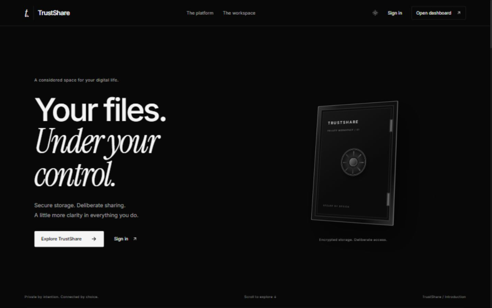 |
| Entrance, light | 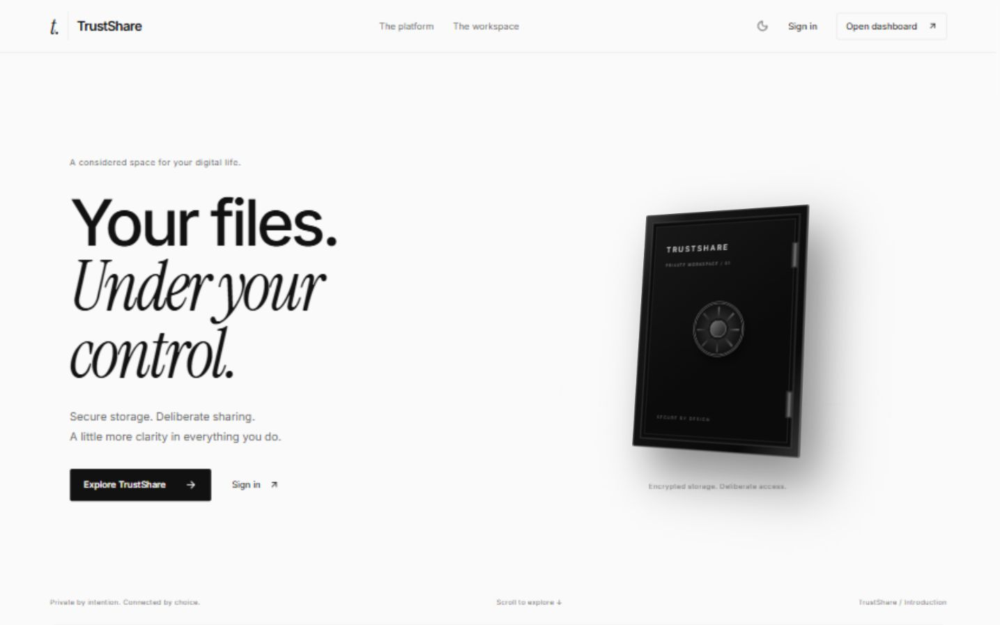 |
| System | 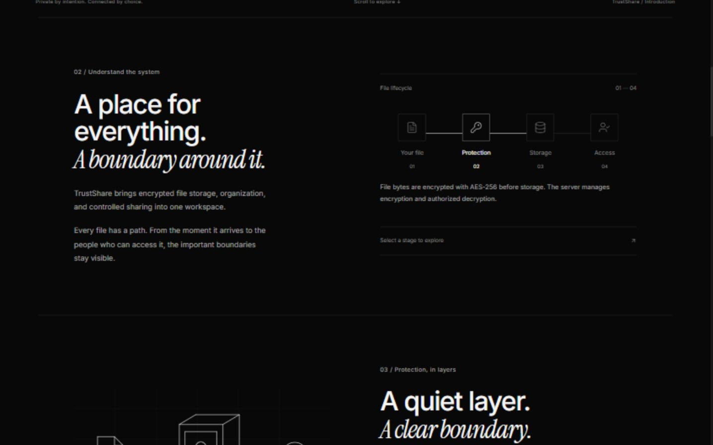 |
| Protection | 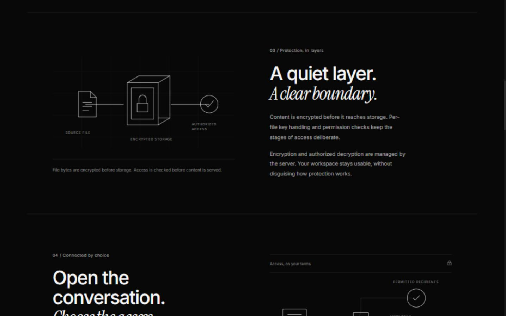 |
| Sharing | 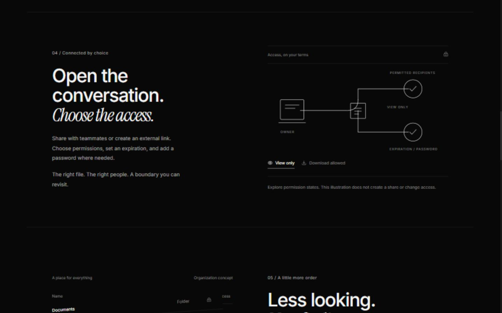 |
| Organization | 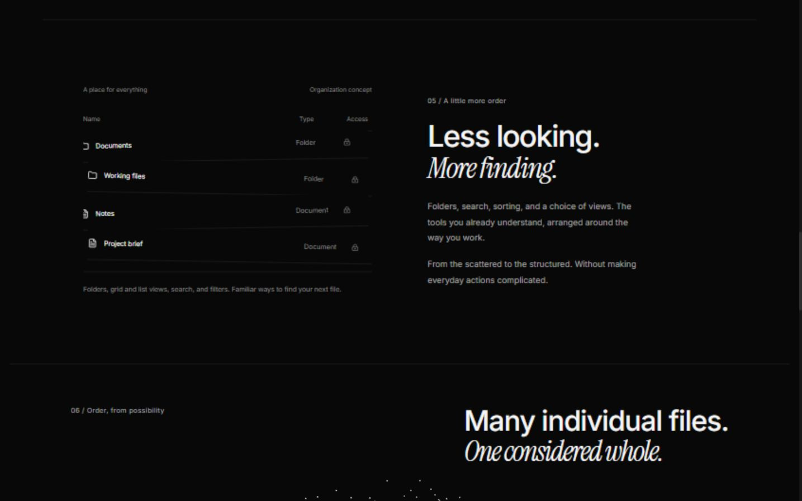 |
| Formation | 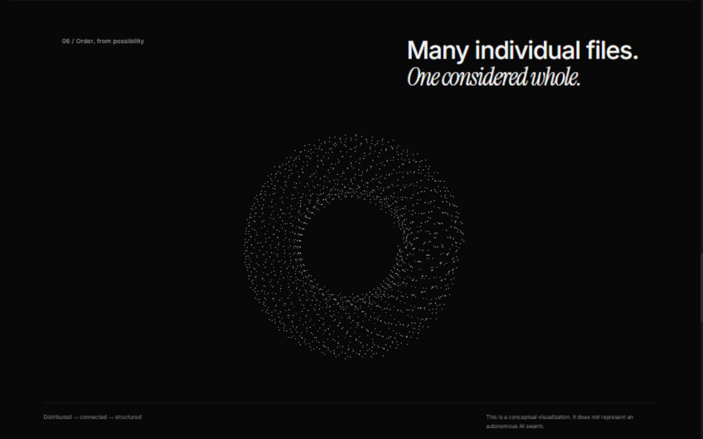 |
| Formation progress | 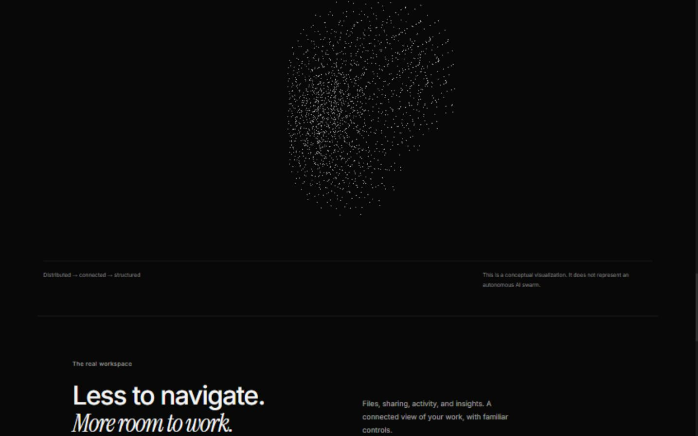 |
| Actual dashboard component | 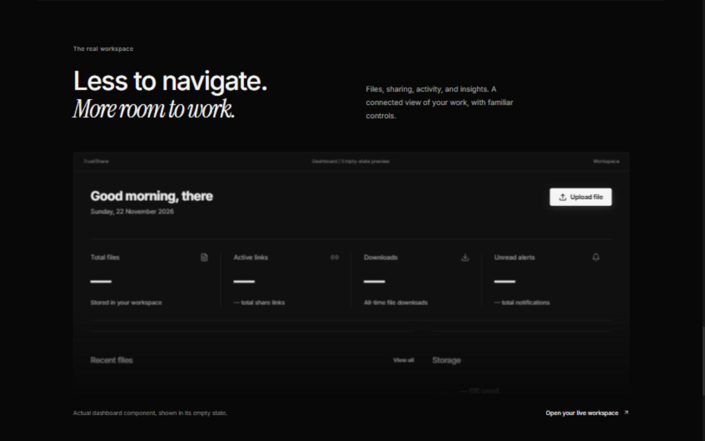 |
| Product preview, light | 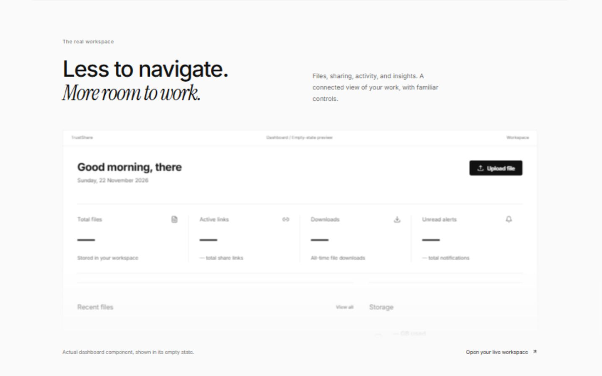 |
| Closing | 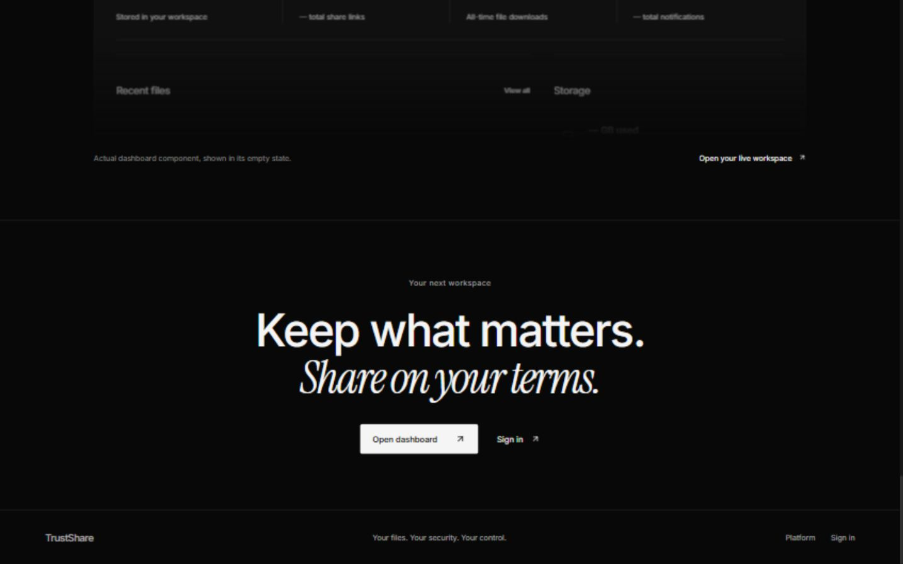 |
| Login, dark | 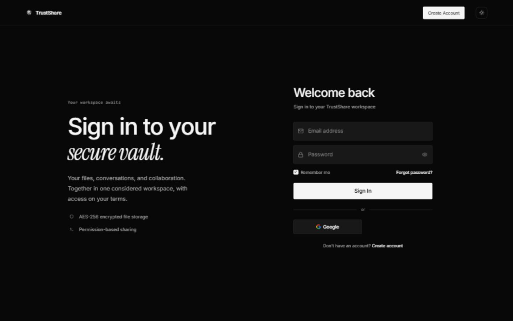 |
| Login, light | 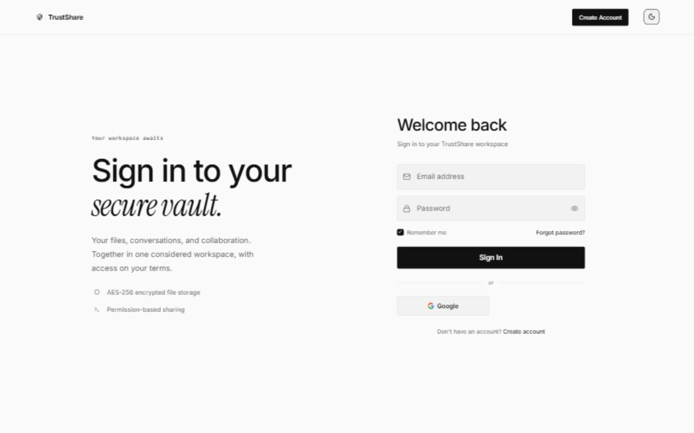 |

Mobile authentication: [dark](design/login-390-dark.jpg) and [light](design/login-390-light.jpg). The narrative is hidden on narrow screens, the form is centered, and inputs/password toggles have accessible names. Selected controls use readable foregrounds in both themes.

Responsive entrance screenshots: [390px](design/home-390-light.jpg), [768px](design/home-768-light.jpg), [1024px](design/home-1024-light.jpg), [1920px](design/home-1920-light.jpg). A 1440px dark/light entrance was also inspected. All five representative widths had document scroll width equal to client width. These are representative visual checks, not an exhaustive accessibility certification.

## Verification and known limits

The normal optimized CRA build passed, with its large-main-bundle advisory (approximately 566KB gzip). A separate output directory was used to preserve the running local preview:

```powershell
$env:BUILD_PATH='build-release'
$env:GENERATE_SOURCEMAP='false'
npm run build
```

The final working-tree frontend run (including earlier local functional fixes outside this PR) has 9 suites passing and 6 failing; 58 tests pass and 12 fail. The final focused landing and layout/authorization run passes all 21 tests across two suites. Thirteen staged auth handlers also match their original committed implementations. The original committed frontend was separately extracted and tested without modifying the working tree: 6 suites passed and 6 failed; 36 tests passed and 12 failed. The same six failing suites occur in both trees: FileDragDrop, Notifications, PublicShare, ActivityPage, Sharing, and NavbarNotifications. They involve stale control/class expectations, a missing Sharing export, and Jest parsing of an ESM dependency. These unrelated functional/test problems were left untouched.

Browser review uses the ChatGPT in-app browser only. It checks visual rendering and navigation, not a complete new end-to-end exercise of email delivery, OAuth providers, destructive admin actions, upload encryption, or public downloads. The dashboard shows an em dash when an existing API metric is absent; no fabricated zero is inserted. A native walkthrough recording was unavailable, so the scene captures and review instructions are supplied instead.

The existing admin session was used to inspect Dashboard, My Files (grid/list), Sharing, Shared with Me, Activity, Notifications, Analytics, Admin, Settings, and the assistant's configuration-required state. Folder and sharing dialogs were opened and dismissed without creating records. Login theme switching and password visibility were checked. Dashboard and My Files also fit at 390px. A real mobile Analytics overflow was corrected with shrinkable grid tracks/cards and wrapping headers, then rechecked at 390px: scroll width equals client width. Member-only visibility and role guards were covered by the passing layout tests; a separate member browser session was not used. The local AI assistant still requires its existing API-key configuration.

## Changed areas

- Public routing and page-title matching: `App.js`, `layout/PageTitle.js`.
- New landing, scene visuals, formation, tests, and landing stylesheet: `features/landing/`.
- Shared tokens and restrained composition: `styles/tokens.css`, `styles/experience.css`.
- Auth presentation and obsolete-style cleanup: Login, Signup, ForgotPassword, ResetPassword, VerifyOtp, and `styles/apple-auth.css`. Existing auth request handlers are preserved.
- Shared shell, dashboard, file manager, sharing, activity, notifications, settings, assistant, public-share presentation, and analytics feature styles/inline colors.
- Analytics view colors and line/bar encodings; underlying metrics and calculations are preserved.

Earlier uncommitted backend, SMTP, upload, OAuth callback, and deployment work is excluded from this visual review branch. The VerifyOtp resend-error behavior is also excluded from this change, while its decorative cleanup is included.
