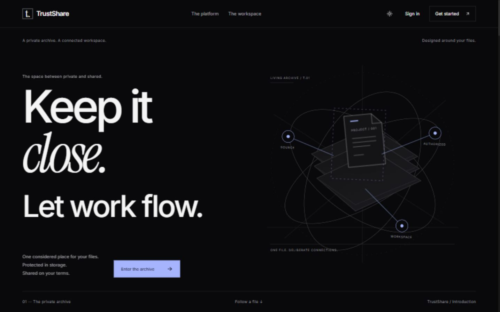
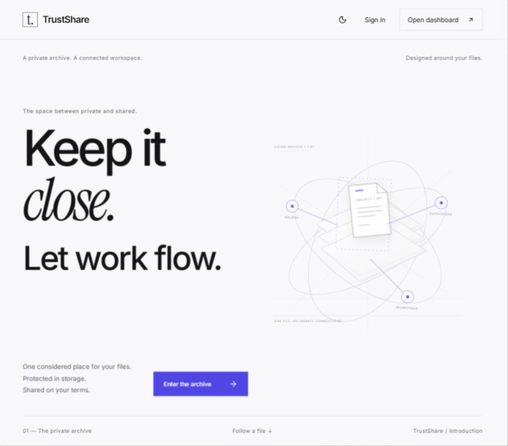
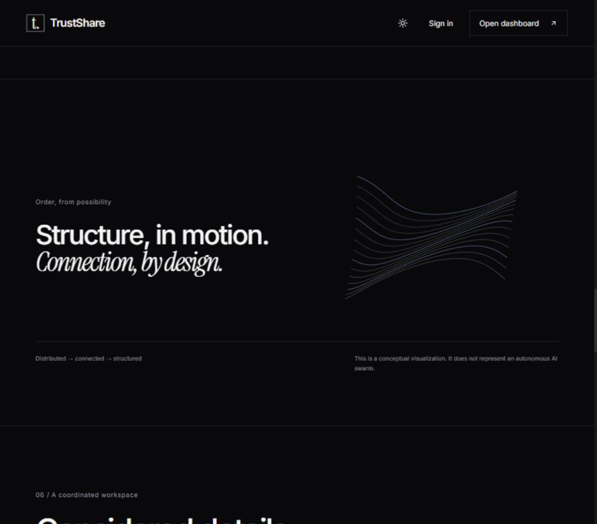
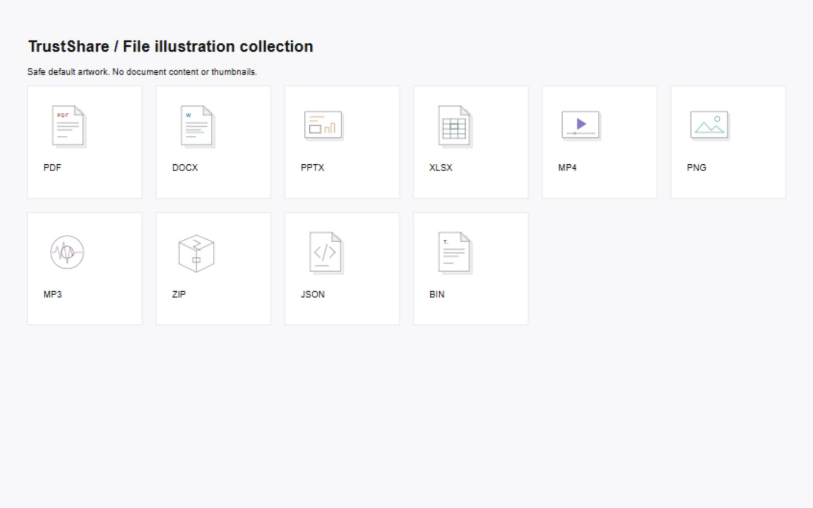
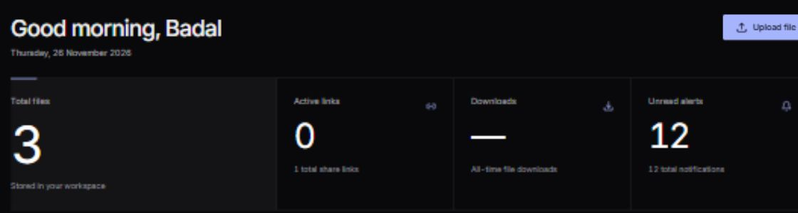

# Phase II — Living Archive review

Review branch: `codex/living-archive-phase-two`, based on `codex/advanced-motion-refinement` (6d5b649). This is a stacked review; nothing is merged or deployed to AWS.

## Implemented

The oversized homepage vault is replaced by **LivingArchive**, a compact SVG sculpture with document layers, protective boundaries, authorized destinations and orbital paths. Existing pointer springs move its framing, while independent scroll transforms rotate and separate its architectural planes. The editorial headline and existing downstream file journey remain. Reduced motion retains a static illustration.

The former dotted particle field is now a **line-based architectural sculpture**. Orbital lines interpolate into an ambient wireframe wave and organized planes. It uses the existing Canvas lifecycle, IntersectionObserver/ResizeObserver cleanup, bounded pixel ratio and adaptive complexity. Drawing is batched by strand rather than issuing a stroke per segment. SVG orbital geometry provides the non-Canvas fallback. No WebGL dependency was added.

The existing swarm has an accessible **Replay construction** control. It resets only the construction clock, completed flag and visual build properties. The effect cleanup cancels the prior timer/RAF/observer before the new run. It does not refresh, change theme, or explicitly scroll the page. Cursor count and the 13.5-second deadline remain unchanged. The replay toolbar wraps on narrow screens.

The file-artwork system now distinguishes PDF, word-processing documents, landscape slides, spreadsheets, cinematic media, images, circular audio waveforms, archive packages and technical/code files. Unknown/null metadata falls back safely. Small category accents, brief layer separation and audio hover feedback preserve neutral cards. No thumbnails, file-content requests or accepted-format changes were added. [Standalone illustration collection](FILE_ILLUSTRATION_COLLECTION.html).

## Color and application refinements

Neutral surfaces remain dominant. Light mode uses #f8f8fa/#fff/#f1f1f4, dark mode #09090b/#141416/#1c1c20. Indigo is the single interactive accent (#4f46e5 light, #a5b4fc dark). Green, amber and red now identify meaningful status states. Chart series use coordinated indigo/teal/neutral/amber tones; existing legends and values remain. Active navigation and focus inherit the brand signal.

Dashboard storage uses the existing byte value and formatter below 1GB instead of displaying small usage as rounded gigabytes. Metric hierarchy, storage progress and quick-action feedback receive selective accents. The five-column desktop Analytics KPI grid avoids an orphan fifth card; smaller screens retain the established two/single-column behavior. Authentication, assistant, notifications and settings inherit the shared tokens without changing processing or handlers. The circular theme transition is preserved.

## Inactive share deletion — deliberate backend exception

Existing `DELETE /api/shares/{id}` still revokes. A separate owner-authenticated `DELETE /api/shares/{id}/record` archives eligible inactive records. Active, unexpired links return 409 and other owners receive 404. Expired links are made inactive before archival. Repeated archival is idempotent.

A new `share_link_archives` table records the archive marker. The existing startup `Base.metadata.create_all` registers it through the ShareLink module; existing ShareLink rows are not altered or deleted. The original file, token, audit events, access count and analytics foreign-key targets remain. Owner list results exclude archived markers. Public access remains rejected because the original link is inactive. This is persistent server state, not a localStorage/React-only filter.

The UI exposes Delete Link only for revoked/expired records, uses the existing confirmation/loading dialog, updates through the existing list refresh, and animates removal through AnimatePresence. The confirmation explicitly states that the original file/security history remain. Other sharing rules are unchanged.

## Verification

- Production build passed with the existing lint/large-bundle warnings (`CI=false`, source maps disabled). Main JS is 571.63kB gzip; CSS 46.67kB; lazy homepage JS/CSS 9.14/4.80kB. No dependency was added.
- Three isolated SQLite service tests passed: archival persistence/idempotence, preservation of file/link/audit rows, public-access rejection, ownership rejection, active-link rejection and expired-link eligibility. Tests run against in-memory data, not the application's database.
- Frontend full working-tree suite: **76 passed, 9 existing failures, 85 total**, with 15 passing and five failing suites. The same baseline failures remain in FileDragDrop, Notifications, Activity, Sharing and NavbarNotifications ESM setup. New replay coverage exercises three consecutive deadlines and checks that cursor nodes do not multiply; file-artwork coverage checks category separation and null metadata. Initial focused run: 14 tests passed.
- Actual local browser sign-in succeeded. A previously created disposable `ui-regression.txt` link was archived through the confirmation dialog, remained absent after refresh, and its original 197-byte file remained visible in My Files. No real user file or production share was deleted.
- Two browser replays completed in **13,512ms and 13,510ms**. Theme switching during replay retained the activated clock and the 16 cursor nodes. Completion was checked after leaving/returning; no page refresh was used.
- Desktop hero, light/dark artwork, wireframe surface, file illustration gallery, Dashboard storage and Sharing confirmation were inspected in the ChatGPT in-app browser. This is representative visual validation, not a claim that every route/viewport/state combination was checked.
- Homepage checks included 1920, 1440, 1280, 1024, 768, 390 and 320px. Final narrow header fits without wrapping its account action; sampled document widths reported no horizontal overflow. Cross-route checks at every one of these widths were not exhaustive.

## References and limitations

The latest `20261125-1506-36.0642866.mp4` review recording was inspected using timed frames (42.33-second duration). It showed the prior Dashboard/Sharing/Analytics composition and the orphan KPI. Prior-phase WAYNE architectural and Teja portfolio research informed the visual language; their assets/branding were not copied.

The browser tool exposes still captures, not screen recording. No replay/walkthrough video was captured. Reduced motion is covered by component tests and static alternatives; OS preference emulation, screen-reader testing, a complete modal focus audit, measured FPS/CPU and external Google/MFA flows are not claimed. Existing assistant setup/provider limitations and the Dashboard's unavailable Downloads metric remain outside this scope. The large shared JavaScript bundle and existing lint warnings remain.

Pre-existing local Docker, OAuth/MFA, SMTP, uploads, notifications and provider work is excluded from this review. The only backend changes are the inactive-share archive model, service, route and isolated tests. The local container was refreshed for validation; production infrastructure was not changed.

## Evidence

The previous vault baseline is in [Phase I evidence](screenshots/refinement/after-hero-dark.png). This review includes public/synthetic artwork and a cropped aggregate Dashboard region, excluding private filenames/account details.

## Modified paths

- `project-root/client/src/components/FileArtwork.js`
- `project-root/client/src/components/FileArtwork.test.js`
- `project-root/client/src/components/file-artwork.css`
- `project-root/client/src/features/analytics/analytics.css`
- `project-root/client/src/features/analytics/config/chartTheme.js`
- `project-root/client/src/features/dashboard/components/DashboardOverview.js`
- `project-root/client/src/features/dashboard/dashboard.css`
- `project-root/client/src/features/landing/Landing.js`
- `project-root/client/src/features/landing/LivingArchive.js`
- `project-root/client/src/features/landing/ParticleFormation.js`
- `project-root/client/src/features/landing/SwarmConstruction.js`
- `project-root/client/src/features/landing/SwarmConstruction.test.js`
- `project-root/client/src/features/landing/living-archive.css`
- `project-root/client/src/features/landing/swarm-construction.css`
- `project-root/client/src/features/sharing/SharingHub.js`
- `project-root/client/src/features/sharing/sharing.css`
- `project-root/client/src/styles/tokens.css`
- `project-root/client/src/utils/api.js`
- `project-root/docs/FILE_ILLUSTRATION_COLLECTION.html`
- `project-root/docs/PHASE_TWO_REFINEMENT.md`
- `project-root/docs/screenshots/phase-two/archive-confirm.png`
- `project-root/docs/screenshots/phase-two/dashboard-metrics.png`
- `project-root/docs/screenshots/phase-two/file-collection.png`
- `project-root/docs/screenshots/phase-two/hero-dark.png`
- `project-root/docs/screenshots/phase-two/hero-light.png`
- `project-root/docs/screenshots/phase-two/mobile-320.png`
- `project-root/docs/screenshots/phase-two/sculpture.png`
- `project-root/server/src/entities/share_link.py`
- `project-root/server/src/shares/controller.py`
- `project-root/server/src/shares/service.py`
- `project-root/server/tests/test_share_archive.py`
